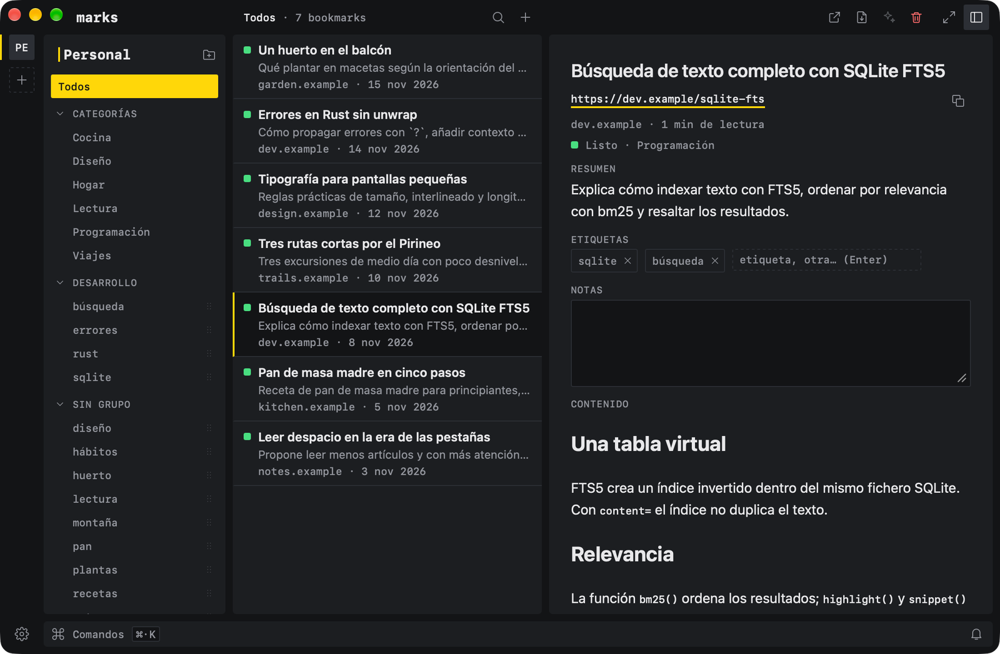

# marks

[English](README.md) · **Español**

Bookmarks local-first para macOS. Guardas una URL y marks descarga la página, la convierte en Markdown y la guarda en un fichero SQLite en tu equipo, lista para leer y para buscar en el texto completo. Si activas la IA (desactivada por defecto, y local por defecto), además escribe un resumen, propone categoría y etiquetas, y añade búsqueda semántica.



- **Tus datos se quedan contigo.** Un fichero SQLite por perfil. Sin cuenta, sin servidor y sin telemetría.
- **Lee sin cargar nada remoto.** Las páginas guardadas son texto; las imágenes y el contenido incrustado son un enlace que abres tú.
- **IA opcional.** [Ollama](https://ollama.com) en tu equipo, o OpenAI, Anthropic y servidores compatibles con OpenAI.
- **Extensión de navegador** para navegadores Chromium (recomendada) y Safari (experimental).
- **Importa y exporta** el fichero `bookmarks.html` de Chrome y Safari.
- **En español y en inglés.**

## Estado

La versión 1.0 es para macOS 14.5 o posterior. Apple Silicon es la única plataforma probada; la versión para Intel se publica sin probar. Windows y Linux llegarán más adelante.

## Instalación

Descarga el DMG de la [última versión](https://github.com/landygg/marks/releases/latest) y arrastra marks a Aplicaciones.

marks no está notarizada por Apple: la primera vez, macOS la bloquea y la abres desde Ajustes del Sistema → Privacidad y seguridad → «Abrir igualmente». Ver [Instalación y primer arranque](docs/es/installation.md).

## Documentación

- **Usuarios:** [docs/es](docs/es/README.md): guardar, buscar, perfiles, IA, la extensión del navegador, copias de seguridad, privacidad y problemas frecuentes.
- **Desarrolladores:** [docs/es/developers](docs/es/developers/README.md): arquitectura, compilación, reglas del repositorio, traducciones, migraciones y la API local.
- **Contribuir:** [docs/es/developers/contributing.md](docs/es/developers/contributing.md).
- **Cambios de cada versión:** [CHANGELOG.md](CHANGELOG.md), en inglés.

## Compilar desde el código

```sh
pnpm install
pnpm --dir apps/desktop tauri dev      # ejecuta la app
scripts/check.sh                       # todas las comprobaciones, antes de cada commit
```

Los requisitos y el resto de comandos están en [Compilar y verificar](docs/es/developers/building.md).

El repositorio es un workspace de Cargo y de pnpm:

| Ruta | Qué es |
|---|---|
| `crates/core` | La biblioteca: almacenamiento, extracción, IA y búsqueda. Aquí vive toda la lógica |
| `crates/i18n` | Todos los textos de usuario de la parte en Rust, en inglés y en español |
| `crates/cli` | La herramienta de línea de comandos `marks` |
| `apps/desktop` | La app de escritorio (Tauri 2 y Svelte 5) |
| `apps/extension` | La extensión del navegador (Manifest V3), con el manejador de Safari |
| `packages/extract` | El extractor de página a Markdown que comparten la app y la extensión |

## Licencia

[MIT](LICENSE).
