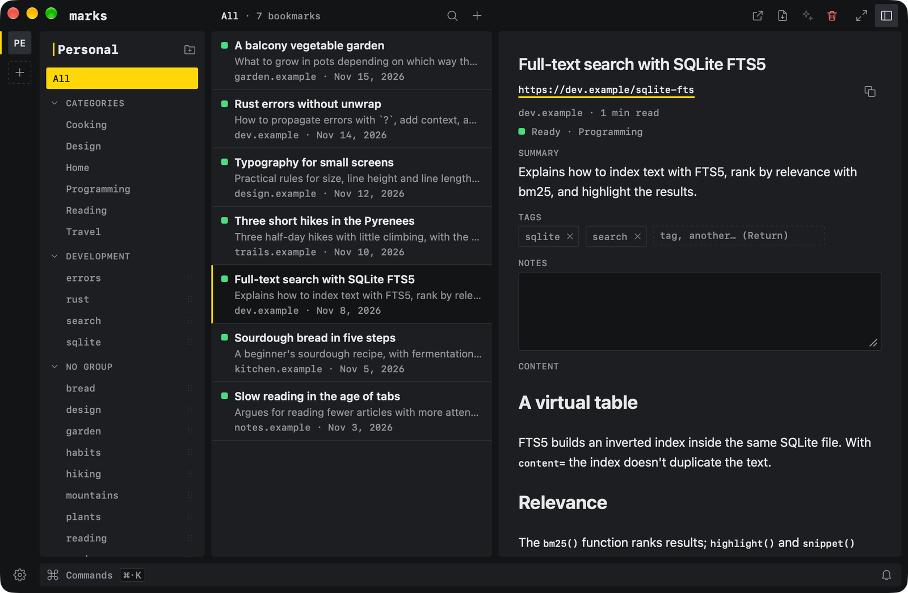

# marks

**English** · [Español](README.es.md)

Local-first bookmarks for macOS. Save a URL and marks downloads the page, turns it into Markdown and keeps it in a SQLite file on your computer, ready to read and to search in full text. Turn on AI (off by default, local by default) and it also writes a summary, suggests a category and tags, and adds semantic search.



- **Your data stays with you.** One SQLite file per profile. No account, no server, no telemetry.
- **Reads without loading anything remote.** Saved pages are plain text; images and embeds are a link you open yourself.
- **Optional AI.** [Ollama](https://ollama.com) on your machine, or OpenAI, Anthropic and OpenAI-compatible servers.
- **Browser extension** for Chromium browsers (recommended) and Safari (experimental).
- **Import and export** the `bookmarks.html` file that Chrome and Safari use.
- **In English and Spanish.**

## Status

marks is for macOS 15 or later. Apple Silicon is the only tested platform; the Intel build is published untested. Windows and Linux will come later.

Still on macOS 14? Stay on [marks 1.1.0](https://github.com/landygg/marks/releases/tag/v1.1.0), the last version for it: from 1.2.0 on, marks no longer opens on macOS 14. If you already updated, download the 1.1.0 DMG, open it and drag `marks.app` to Applications, replacing the one there. Your bookmarks are untouched: 1.2.0 doesn't change the database.

## Install

Download the DMG from the [latest release](https://github.com/landygg/marks/releases/latest) and drag marks to Applications.

marks is not notarized by Apple: the first time, macOS blocks it and you open it from System Settings → Privacy & Security → “Open Anyway”. See [Installation and first launch](docs/en/installation.md).

## Documentation

- **Users:** [docs/en](docs/en/README.md) — saving, searching, profiles, AI, the browser extension, backups, privacy and troubleshooting.
- **Developers:** [docs/en/developers](docs/en/developers/README.md) — architecture, building, repository rules, translations, migrations and the local API.
- **Contributing:** [CONTRIBUTING.md](CONTRIBUTING.md).
- **What changed in each version:** [CHANGELOG.md](CHANGELOG.md).

## Build from source

```sh
pnpm install
pnpm --dir apps/desktop tauri dev      # run the app
scripts/check.sh                       # every check, before each commit
```

Requirements and the rest of the commands are in [Building](docs/en/developers/building.md).

The repository is a Cargo and pnpm workspace:

| Path | What it is |
|---|---|
| `crates/core` | The library: storage, extraction, AI, search. All the logic lives here |
| `crates/i18n` | Every user-facing text of the Rust side, in English and Spanish |
| `crates/cli` | The `marks` command-line tool |
| `apps/desktop` | The desktop app (Tauri 2 and Svelte 5) |
| `apps/extension` | The browser extension (Manifest V3), with the Safari handler |
| `packages/extract` | The page-to-Markdown extractor shared by the app and the extension |

## License

[MIT](LICENSE).
