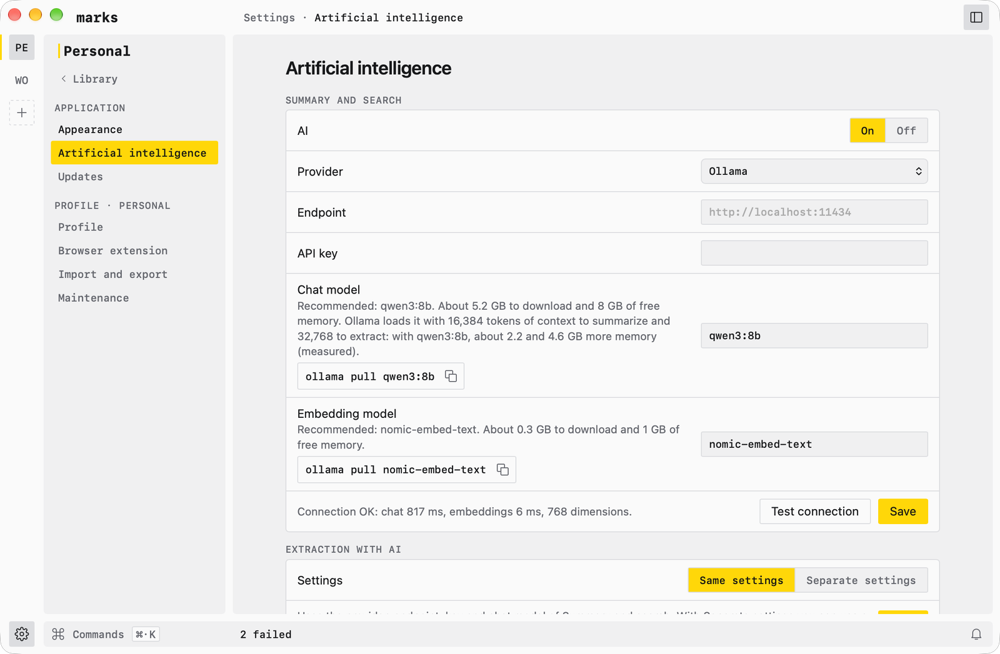

# Artificial intelligence

[Español](../es/ai.md) · **English**

AI is optional and **off by default**. marks works without it: it saves, extracts, displays and searches the text.

## What it adds

| With AI | Without AI |
|---|---|
| A summary of each page | No summary; the list shows the page's description |
| A suggested category and tags | Only your own tags |
| Semantic search, by meaning | Full-text search only |
| “Extract with AI” | Not available |

Without AI, bookmarks are extracted and stay at “Not summarized”. Settings puts it this way: “Without AI, bookmarks are extracted and stay pending, with no summary, tags or semantic search.”

## Providers

| Provider | Where it runs | Endpoint | Key |
|---|---|---|---|
| “Ollama” (default) | On your computer | `http://localhost:11434` unless you set another | No |
| “oMLX” | On your computer or your network | Required | Optional |
| “OpenAI-compatible” | Wherever the server is | Required | Optional |
| “OpenAI” | Remote | The provider's | Yes |
| “Anthropic” | Remote | The provider's | Yes |

**With a remote provider, the content of every page marks summarizes leaves your computer for that provider.** With Ollama on `localhost`, nothing leaves. See [Privacy](privacy.md).

Anthropic doesn't offer embeddings: with it you get summaries but no semantic search. The app says so: “Anthropic doesn’t offer embeddings: search needs another provider.”

## Turning it on with Ollama (local)

1. Install [Ollama](https://ollama.com) and leave it running.
2. Download the two default models:

   ```sh
   ollama pull qwen3:8b
   ollama pull nomic-embed-text
   ```

   | Model | What for | Download | Free memory |
   |---|---|---|---|
   | `qwen3:8b` | Summary, category and tags | about 5.2 GB | about 8 GB |
   | `nomic-embed-text` | Semantic search | about 0.3 GB | about 1 GB |

3. In marks: Settings (⌘,) → “Artificial intelligence”.
4. Under “AI”, choose “On”.
5. Under “Summary and search”, leave “Provider” on “Ollama”. “Chat model” and “Embedding model” already hold the defaults.
6. Click “Save” and then “Test connection”.

“Test connection” tests the **saved** settings. When it works, it answers something like “Connection OK: chat 850 ms, embeddings 40 ms, 768 dimensions.”



Next to each model field the app shows the recommended model for that provider, the “Use” button and, with Ollama, the `ollama pull …` command with “Copy command”.

marks asks Ollama for more context than its default: 16,384 tokens to summarize and 32,768 to extract. That takes more memory; with `qwen3:8b`, about 2.2 and 4.6 GB more.

## Turning it on with another provider

1. Settings → “Artificial intelligence” → “AI”: “On”.
2. Choose the “Provider”.
3. If the provider needs one, fill in “Endpoint” (“Required with this provider.”).
4. Type the “Chat model” and the “Embedding model”.
5. Type the “API key”, if one is needed.
6. “Save” and “Test connection”.

### Where the key is stored

Only in the **macOS Keychain**, under the service `dev.landygg.marks`. Never in the database or in a file. When one is stored, the app says “A key is saved in the keychain.” “Remove key” deletes it when you save.

## After turning it on

Saving the settings with AI on wakes the background process: whatever was extracted without AI and was waiting for its summary is processed on its own. So is everything you save from now on.

The semantic search vectors depend on the embedding model. If you change it and save, marks queues the bookmarks of **every profile** again to recompute them. Until that finishes, search in a profile uses full text only.

Settings → “Maintenance” has two manual actions, in case you need them. They act on the **active profile**:

- “Process bookmarks without a summary” → “Process”. It shows how many are pending and queues them.
- “Reindex embeddings” → “Reindex”. It recomputes the vectors of every bookmark in the profile.

AI settings and keys are app-wide, not per profile.

## Turning it off

Settings → “Artificial intelligence” → “AI”: “Off” → “Save”. marks stops calling the model from the next bookmark on. What was already summarized is kept.

## Extract with AI

Some pages don't extract well the normal way. “Extract with AI”, in the detail or in the palette, loads the page in a hidden window, cleans its HTML and hands it to a model, which converts it to Markdown. The bookmark is marked “Extracted with AI”.

- It needs AI on and a model. Otherwise the button says so: “Extract with AI needs a model: turn it on and set it up in Settings → Artificial intelligence.”
- If the bookmark already has content, it asks first, and only replaces it if the result is valid.
- The input is cut at 60,000 characters. The model call is treated as failed after 5 minutes.
- It isn't offered for a page blocked by an anti-bot check.

### A separate model for extraction

By default it uses the provider and chat model of “Summary and search” (“Same settings”). Some models are built to turn HTML into Markdown, such as ReaderLM-v2, and you can use one just for this, even on another machine on your network:

1. Settings → “Artificial intelligence” → “Extraction with AI” → “Settings”: “Separate settings”.
2. Choose the provider, the “Endpoint” (for example `http://192.168.1.20:11434`) and the “Model”.
3. “Save” and “Test connection”.

Its key, if it needs one, is stored in the Keychain separately from the summary key.

With an endpoint outside your computer, the app warns: “Extract with AI sends the page’s HTML to a server outside this computer.”

## Limits

- The text sent for summarizing is cut at 12,000 characters.
- For semantic search, each page is split into chunks of about 1,500 characters, up to 40 per page. Anything past that isn't in semantic search, but it is in full-text search.
- The quality of the summary, category and tags depends on the model you pick.

If something goes wrong, see [Troubleshooting](troubleshooting.md#artificial-intelligence).
