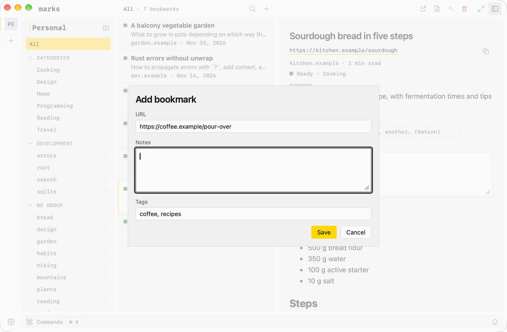
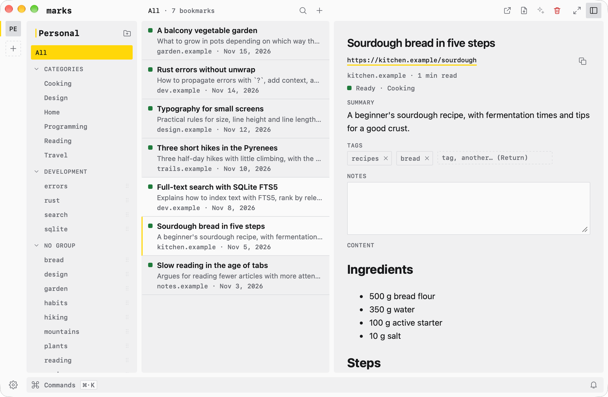

# Saving and reading bookmarks

[Español](../es/bookmarks.md) · **English**

## Saving a page

There are four ways:

| From | How |
|---|---|
| The app | ⌘N, the “Add” button on the list, or the “Add bookmark” command in the palette |
| The menu bar | marks icon → “Add URL…” |
| The browser | The [extension](browser-extension.md): click its button or press ⌥⇧M |
| The terminal | `marks add <URL>`. See [Command line](cli.md) |

The “Add bookmark” dialog asks for the URL and, optionally, notes and tags (separated by commas). Only `http` and `https` URLs can be saved.

The bookmark goes into the active profile. From the extension, it goes into the profile that owns the token.

### Duplicates

marks doesn't save the same page twice in one profile. To compare pages it normalizes the URL: it drops `utm_…` parameters and the fragment (`#section`), except fragments that start with `#/` or `#!`, which are routes of a web app. If the URL was already there, marks returns the existing bookmark unchanged.

The URL as you typed it is kept: it's the one “Open in browser” opens and the one that gets exported.

## What happens after you save

marks works in the background, one bookmark at a time, taking turns across all profiles:

1. It **downloads** the page over HTTP.
2. If that fails or brings back too little text, it **loads the page in a hidden window**, without your browser session, so its JavaScript runs.
3. It **extracts** the main content and converts it to Markdown. It also stores the metadata (description, author, site, date, language) and the favicon.
4. With AI on, it asks for the **summary**, category and tags, and computes the **vectors** for semantic search.

While extraction runs, the row and the detail show “Extracting”, and the status bar shows “Extracting “title””.

Pages saved from the extension arrive already extracted by the browser, with your session, so steps 1 to 3 aren't needed.

### Statuses

Each row has a status dot:

| Status | What it means |
|---|---|
| “Not extracted” | Imported from a file; marks hasn't downloaded anything yet. See [Import and export](import-export.md) |
| “Not summarized” | Saved and queued, or already extracted but with no summary. Without AI, bookmarks stay here |
| “Waiting to be indexed” | Summarized; the semantic search vectors are still missing |
| “Ready” | Extracted, summarized and indexed |
| “Failed” | It couldn't be downloaded or processed. The detail shows the error |

### When it fails

The detail of a failed bookmark shows the error message, with “Copy message”, and the “Retry” button. Common cases:

- **The page doesn't exist or the server is failing** (404, 410 or 5xx): marks doesn't try the hidden window. Use “Retry” later.
- **The page asks you to sign in**: marks doesn't have your session. Save it from the extension.
- **The page asks for an anti-bot check** (a captcha): the row says “Blocked by an anti-bot check”. Click “Open in browser”, complete the check and save the page with the extension; the bookmark is filled in with that content.

Every failure also leaves a notification. See [Settings, notifications and the status bar](settings.md#notifications).

## Reading

Select a bookmark in the list. The detail shows:

- The **title**, which you can edit.
- The **URL**, shortened if it's long, with “Copy link”.
- A line of **metadata**: site, author, date and reading time (at 200 words per minute).
- The AI **summary**, if there is one.
- The **tags**, with a field to add more (“tag, another…” and Return). Each one has its own remove button.
- The **notes**, which save themselves as you type.
- The extracted **content**.

In the list, each row shows the summary or, when there isn't one, the page's description.

### How content is shown

Content is formatted text: headings, lists, quotes, tables, code and links. For safety and privacy, **marks loads nothing remote when you read**:

- Images, videos, audio and embedded content show up as a single line (“Image”, “Video”, “Audio”, “Embedded content”) with an “Open” button that opens them in the browser.
- Links open in your browser, and only if they are `http` or `https`.
- The page's HTML is never executed.

The favicon is visible: marks downloads it once when you save and keeps it in the database.

“Expand” enlarges the detail until it covers the list; “Collapse” puts it back.

## Detail actions

The strip at the top of the detail has one button per action. All of them are in the command palette too.

| Button | What it does |
|---|---|
| “Open in browser” | Opens the original URL |
| “Retry” | Failed bookmarks only: puts it back in the queue |
| “Extract” | “Not extracted” bookmarks only: queues it |
| “Extract again” | Repeats the normal extraction |
| “Extract with AI” | Extracts with an AI model. See [Artificial intelligence](ai.md#extract-with-ai) |
| “Delete” | Deletes the bookmark, after you confirm. This can't be undone |

### Extract again

Use it when the content came out incomplete or the page has changed.

- If the bookmark already has content, marks asks first: “The saved content will be replaced with the new extraction.”
- The content is only replaced if the new result is valid. If it comes out nearly empty or is an anti-bot page, the saved content is left alone and marks shows the error.
- The page is loaded without your browser session.
- It isn't offered for a page blocked by an anti-bot check: rescue that one from the extension.

When it's done you get the “Re-extraction finished” notification.

## Limits

- A page with more than 8 MB of HTML isn't downloaded.
- The download waits up to 30 s per request, and the hidden window up to 30 s. An unreachable site can take about a minute to be marked as failed.
- Only HTML pages are saved. A PDF or any other kind of file ends up “Failed”.
- If you add a URL in the app and save it from the extension while marks is still downloading it, the download may overwrite what the extension captured.
