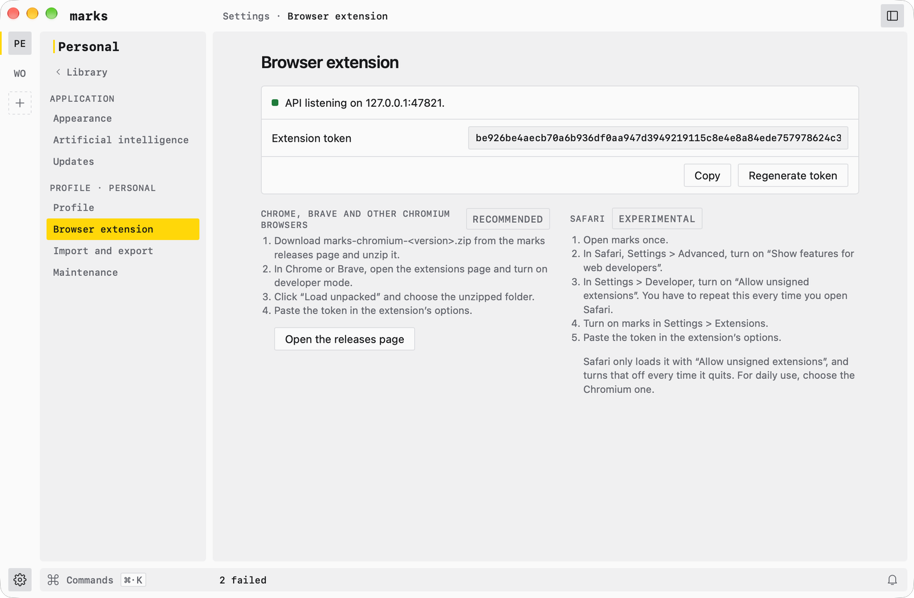

# Browser extension

[Español](../es/browser-extension.md) · **English**

The extension saves the tab you're looking at to marks. It sends the page **as you see it**, already rendered and with your session signed in, so it also works for pages that need a login, that load their content with JavaScript, or that marks couldn't download because of an anti-bot check.

It's the same extension for Safari and for Chromium browsers (Chrome, Brave and others).

## How it works

- The extension talks to the app through a local API at `127.0.0.1:47821`. **marks has to be open** (a closed window with the icon in the menu bar is enough).
- Each marks profile has a **token**. The extension saves to the profile that owns the token pasted into it.
- There is no queue: if marks is closed, the extension doesn't save and says so (“marks is not responding. Open the app and try again.”).

## The token

It's in marks → Settings (⌘,) → “Browser extension”. It belongs to the active profile.

- “Copy” copies it to the clipboard.
- “Regenerate token” creates a new one, after you confirm. The extension stops working until you paste the new one.

The same section tells you whether the API is running: “API listening on 127.0.0.1:47821.”

The token is a local password: anyone who has it and can run programs on your computer can add bookmarks to that profile. Don't publish it.

## Chrome, Brave and other Chromium browsers (recommended)

This is the recommended extension for daily use.

v1.0 isn't on the Chrome Web Store: you load it unpacked.

1. Download `marks-chromium-<version>.zip` from the [releases page](https://github.com/landygg/marks/releases/latest) and unzip it into a folder you won't delete: the browser loads it from there. From source, `apps/extension/dist/chromium` works too, after `pnpm --dir apps/extension build` (see [Building](developers/building.md)).
2. Open `chrome://extensions` and turn on “Developer mode”.
3. Click “Load unpacked” and choose the unzipped folder.
4. Open the extension's options, paste the token and click “Save token”.
5. Click “Test connection”.

Firefox isn't supported.

## Safari (experimental)

In v1.0 the Safari extension ships **inside marks.app**, signed with the same self-signed certificate as the app: there's nothing separate to install. It has its own version, and the app tells it whether the two are compatible.

It's experimental because Apple hasn't signed it: Safari only loads it with “Allow unsigned extensions”, and turns that off every time it quits. For daily use, choose the Chromium one.

1. Open marks at least once, so Safari discovers the extension.
2. In Safari: Settings → Advanced. Turn on “Show features for web developers”.
3. In Settings → Developer, turn on “Allow unsigned extensions”. You have to repeat this every time you open Safari.
4. In Settings → Extensions, turn on “marks”.
5. Open the extension's options, paste the token into “API token” and click “Save token”.
6. Click “Test connection”. It should answer “Connected to the … profile.”

Later on, if the Apple Developer Program is paid for (the Mac App Store requires it), the Safari extension will move to its own app there, with its own update cycle.

Keep a single copy of marks.app on the computer. With two (say, one installed and one you built), Safari may load the extension from the wrong one.

## If the extension and the app aren't compatible

“Test connection” in the extension's options, or an attempt to save, says so with one of these messages:

- “This version of marks is too old for the extension. Update marks.”: update the app (Settings → Updates, or download it from [GitHub](https://github.com/landygg/marks/releases)).
- “The extension is too old for this version of marks. Update it.”: in Chromium, unzip the new version into the same folder, replacing the old one, and press “Reload” in `chrome://extensions`; in Safari, quit Safari and open it again, since the extension comes with the app.

## Saving a page

- Click the extension's button (“Save to marks”), or
- press **⌥⇧M** (`Alt+Shift+M`).

The extension's popup shows the result:

| Message | What it means |
|---|---|
| “Saving…” | In progress. You can close the popup: the save carries on |
| “Saved to the X profile.” | Done |
| “Already saved in the X profile.” | The URL was already there. If it had no content or had failed, it is filled in with what's on screen now |
| “The page asks for verification: complete it and save again.” | What's showing is a captcha, not the page |
| “This page can't be saved.” | It isn't an `http` or `https` page (the browser's settings page, for example) |
| “The API token is missing.” | You haven't pasted the token in the options |
| “The token is not valid.” | The token was regenerated or its profile was deleted |
| “marks is not responding. Open the app and try again.” | marks is closed |
| “The page is too large to save.” | It's over 8 MB even without the fallback text |

If the save fails after you close the popup, the extension's icon shows a `!` until you open it again.

You can change the shortcut in the browser's extension shortcut settings.

## One browser profile per marks profile

The token is kept in the extension's storage, which is separate for each browser profile. Paste the token of a different marks profile into each browser profile, and each one saves to its own.

## Permissions it asks for

| Permission | What for |
|---|---|
| `activeTab` | Read the current tab, only when you click the button or press the shortcut |
| `scripting` | Run the content extractor in that tab |
| `storage` | Store the token |
| `nativeMessaging` | Safari only: talk to marks.app (Chromium doesn't ask for it) |
| `http://127.0.0.1:47821/*` | On Chromium, talk to marks' local API |

It doesn't ask for access to every site, your history or your other tabs. It reads nothing until you ask.

## Privacy

- The page is read from a copy: the one in front of you doesn't change.
- What's extracted goes only to marks, on your computer. The extension connects to nothing else.
- The token lives only in the extension's storage and in the header of each request. It's never handed to the page.

Limitations worth knowing about are in [Privacy](privacy.md#the-local-api).

If something goes wrong, see [Troubleshooting](troubleshooting.md#browser-extension).
