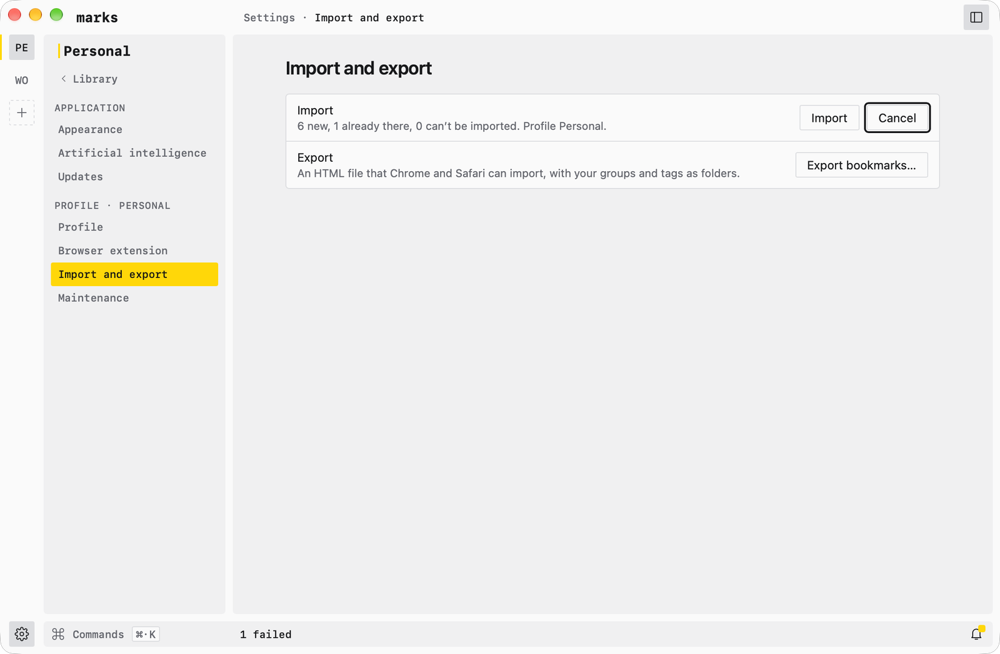

# Import and export

[Español](../es/import-export.md) · **English**

marks trades bookmarks with browsers through the `bookmarks.html` file, the format Chrome and Safari import and export. Use it to bring in what you already had, and to take it out whenever you like.

It has been checked with files from Chrome and Safari. Other browsers use the same format but haven't been tested.

All of this lives in Settings → “Import and export”, and acts on the **active profile**.

## Importing

1. Export the bookmarks from your browser to an HTML file.
2. In marks: Settings → “Import and export” → “Import bookmarks…” (or the palette command of the same name).
3. Pick the file.
4. marks shows a summary **before writing anything**, for example: “12 new, 3 already there, 1 can’t be imported. Profile Personal.”
5. Click “Import” to confirm, or “Cancel”.

The file must be UTF-8 and no larger than 50 MB.

### Imported bookmarks are not extracted on their own

An imported bookmark comes in with its title, URL, date and folders, in the **“Not extracted”** status. marks asks the network for nothing when importing: importing a thousand bookmarks doesn't download a thousand pages.

To extract them:

- **One:** the “Extract” button in the detail.
- **Several:** select a tag (or “All”) and run “Extract the N unextracted bookmarks in this view” from the palette. marks asks you to confirm.

If AI is on, the confirmation warns: “With AI turned on, their N pages will be sent to your provider to be summarized.” Keep that in mind if your provider is remote.

Saving an imported URL again (from the app, the extension or the terminal) also queues it.

### What happens to folders

- A folder becomes a **tag**, in lowercase.
- A folder with subfolders becomes a **group**, and the ones below it are its tags.
- The browser's root folders give no tag: Chrome's bookmarks bar, and Safari's `Favorites`, `Favourites` and `Bookmarks Menu`.
- Safari's **Reading List** is a separate file. Its entries come in with the tag `reading list` (`lista de lectura` when marks runs in Spanish).

### What you already had

A URL that was already in the profile is neither duplicated nor modified: it only gains the tags it was missing.

### What can't be imported

Entries that aren't `http` or `https` (for example `javascript:` or `file:`) and entries with an invalid URL are counted under “can’t be imported” and left out.

## Exporting

1. Settings → “Import and export” → “Export bookmarks…” (or the palette command).
2. Choose where to save. marks suggests the name `marks-<profile>-<date>.html`.

The file holds **the whole profile**, including what is “Not extracted” and “Failed”, inside a `marks` folder:

| Bookmark | Folder in the file |
|---|---|
| With a tag that is in a group | `marks/<group>/<tag>/` |
| With a tag that has no group | `marks/<tag>/` |
| With no tags | `marks/Untagged/` (`marks/Sin etiqueta/` when marks runs in Spanish) |

Each bookmark carries its original URL (with its `#/…` and its `utm_` parameters), its date and its tags.

Notes, summary, extracted content and favicon are **not exported**: the format has no place for them. For a full copy, copy the database files; see [Data and backups](data-and-backups.md). To get the content out as Markdown, see `marks export` in [Command line](cli.md).

## Known limits

- A bookmark with several tags shows up once per tag in the browser that imports the file. When you import it back into marks, it is recognized as a single bookmark.
- More than two levels of folders are flattened: deeper folders become tags of the top group.
- A Safari root folder in another language isn't recognized as a root and becomes a tag.
- On a round trip (export, then import again), groups with no bookmarks are lost.

## From the terminal

`marks import <FILE>` imports without asking and `marks export-html <FILE>` exports the profile. See [Command line](cli.md).
