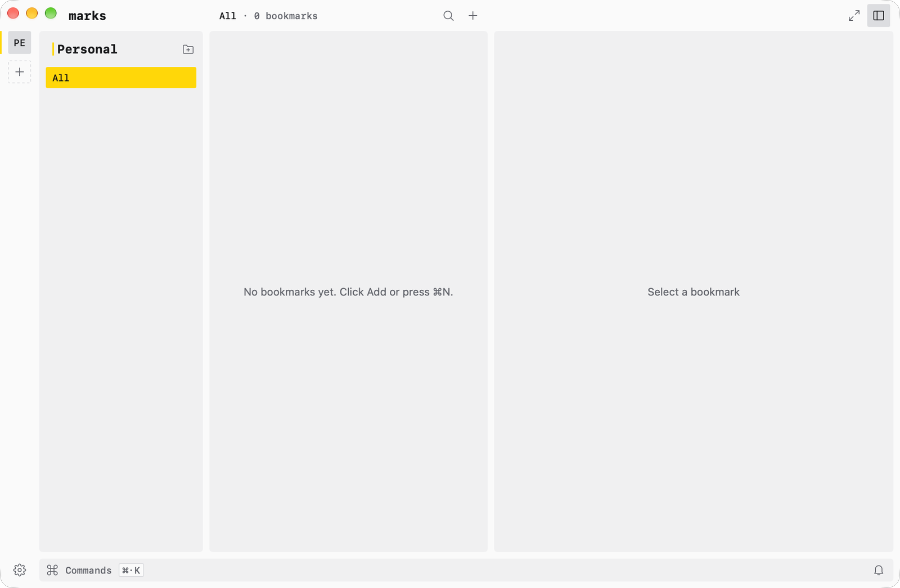

# Installation and first launch

[Español](../es/installation.md) · **English**

## Requirements

- macOS 14.5 or later.
- A Mac with Apple Silicon (the only tested platform). The Intel build is published untested.
- Optional, for local AI: [Ollama](https://ollama.com). See [Artificial intelligence](ai.md).

Windows and Linux will come later.

## Install on macOS

1. Download the DMG of the [latest version](https://github.com/landygg/marks/releases/latest): `marks_<version>_aarch64.dmg` for Apple Silicon, or `marks_<version>_x64.dmg` for Intel (untested).
2. Open it and drag **marks** to the **Applications** folder.
3. Open marks from Applications. The first time, macOS blocks it: follow the steps below.

### The first time: “Open Anyway”

marks is signed, but not notarized by Apple, so the first time macOS won't open it and warns: ““marks” Not Opened. Apple could not verify “marks” is free of malware that may harm your Mac or compromise your privacy.”

1. Click “Done” in the warning (not “Move to Trash”).
2. Open System Settings → Privacy & Security. Near the bottom, next to ““marks” was blocked to protect your Mac.”, click “Open Anyway”. It shows up right after the attempt to open it.
3. Confirm with your password or Touch ID. marks opens.

On macOS 15 and later, Control-click → Open no longer does this: you have to go through Privacy & Security.

If you prefer, in Terminal (it removes the download mark that triggers the warning):

```sh
xattr -dr com.apple.quarantine /Applications/marks.app
```

You only need this the first time: automatic updates don't ask again. A version downloaded by hand does, and so does every update on Intel, which doesn't update itself: you repeat “Open Anyway” each time.

After an update, if you use an AI provider with an API key, macOS may ask once for your keychain password so marks can read the key. Click “Always Allow”.

To build marks from source, see [Building](developers/building.md).

## First launch

The first time it opens, marks creates its database at `~/Library/Application Support/marks/marks.db` and a first profile named “Personal”, with the initials “PE”.

The library is empty and the app says so: “No bookmarks yet. Click Add or press ⌘N.”



### 1. Save your first page

1. Press ⌘N (or click the “Add” button on the list).
2. Paste a URL. Notes and tags are optional.
3. Click “Save”.

The bookmark shows up in the list. marks downloads the page in the background; when it's done, the detail shows the content. Until then, the row and the status bar say “Extracting”.

### 2. Decide whether you want AI

Artificial intelligence starts **turned off**. Without it, marks extracts the content and you can search the text, but there are no summaries, no automatic tags and no semantic search. Bookmarks stay in the “Not summarized” status, and that's expected.

To turn it on: Settings (⌘,) → “Artificial intelligence”. The steps are in [Artificial intelligence](ai.md).

### 3. Connect your browser (optional)

The extension saves the current tab with a click or with ⌥⇧M. It needs a token, which you copy from Settings → “Browser extension”. See [Browser extension](browser-extension.md).

### 4. Bring in your bookmarks (optional)

Settings → “Import and export” → “Import bookmarks…” reads the `bookmarks.html` file that Chrome and Safari export. See [Import and export](import-export.md).

## marks stays open in the menu bar

Closing the window doesn't quit marks: the window is hidden and the app keeps working in the background (it extracts what's pending and answers the extension).

- To get the window back: click the Dock icon, or the marks icon in the menu bar → “Open marks”.
- The menu bar menu also has “Add URL…” and “Quit”.
- To quit marks completely: “Quit” in that menu, or marks → “Quit marks” (⌘Q).

## Language

marks comes in Spanish and English. It follows the system language; if that's neither of the two, it uses English. Change it in Settings → “Appearance” → “Language”. See [Settings](settings.md).

## Uninstall

1. Quit marks.
2. Drag marks from Applications to the Trash.
3. To delete your data too, remove the `~/Library/Application Support/marks/` folder. **This deletes all your bookmarks.** [Data and backups](data-and-backups.md) lists everything else marks leaves on the computer.
