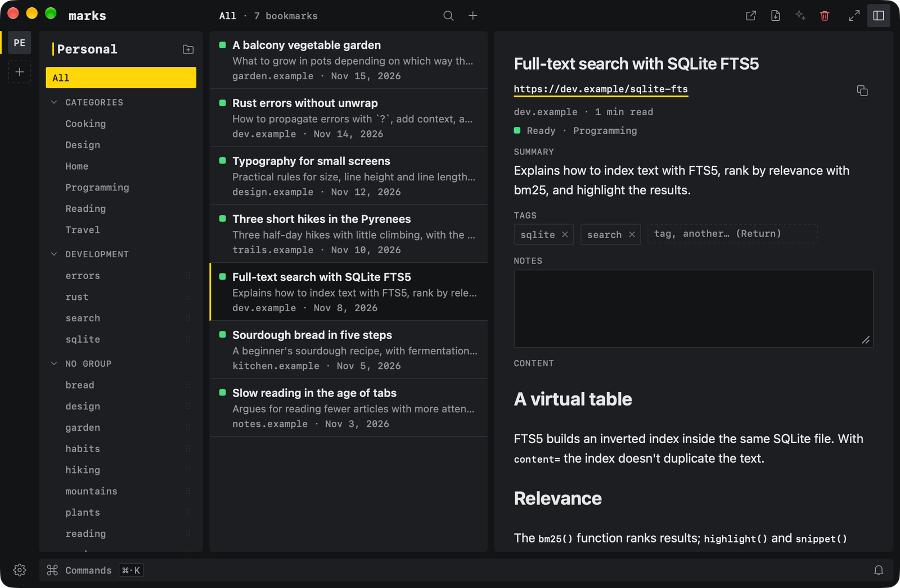

# What marks is

[Español](../es/introduction.md) · **English**

marks saves web pages so you can read them and find them later. You give it a URL; marks downloads the page, turns it into clean text (Markdown) and stores it on your computer. If you turn on artificial intelligence, it also summarizes the page, gives it a category and tags, and indexes it so you can search by meaning.

## What it does

- **It saves the content, not just the link.** If the page goes away, your copy stays.
- **It searches the full text** of everything you've saved: title, content, notes and metadata.
- **It organizes** with tags, tag groups and profiles (separate libraries).
- **It summarizes and tags with AI**, if you want. AI is off by default.
- **It saves from the browser** with an extension for Safari and Chromium browsers.
- **It imports and exports** the `bookmarks.html` file used by Chrome and Safari.

## Local-first and private

- **Your data is a file on your computer.** Each profile is a SQLite database in `~/Library/Application Support/marks/`. There is no account, no marks server and no sync.
- **It works offline** for reading, searching and organizing. It only needs the network to download the pages you save.
- **AI is optional and local by default.** The default provider is [Ollama](https://ollama.com), which runs on your computer. If you pick a remote provider, the content of each page is sent to it; the app tells you so.
- **No telemetry.** marks sends no usage statistics and no crash reports.
- **You can take it with you.** The library exports to `bookmarks.html`, and the command line exports it to Markdown files.

[Privacy](privacy.md) lists exactly what goes out to the network.

## The window

The window has four areas, left to right, and a status bar at the bottom:

1. **Profile rail.** Each profile's initials, and a “+” to create another. See [Profiles](profiles.md).
2. **Sidebar.** “All”, the categories assigned by AI, and your tags, loose or in groups. See [Tags, categories and groups](organizing.md).
3. **List.** The bookmarks of whatever is selected in the sidebar.
4. **Detail.** The selected bookmark: title, summary, tags, notes and content. See [Saving and reading bookmarks](bookmarks.md).

The **status bar** shows what marks is extracting, how many bookmarks are pending or have failed, the state of AI and of the local API, the way into the command palette, and the notifications bell.

There are no search fields in the areas. You search, and run everything else, from the **command palette** (⌘K). See [Search and the command palette](search.md).

⌃⌘S hides the sidebar. Drag the gap between areas to resize the sidebar and the list.

## Platforms

| Platform | Status in v1.0 |
|---|---|
| macOS on Apple Silicon | Tested |
| macOS on Intel | Published untested |
| Windows and Linux | Later |

marks needs macOS 14.5 or later.

## Next

[Installation and first launch](installation.md).
