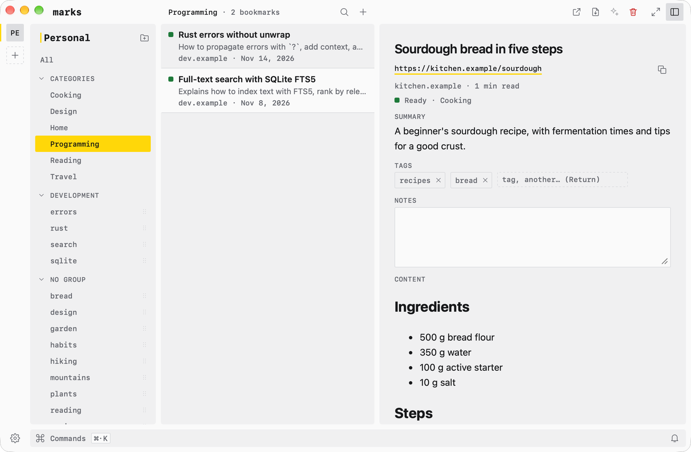

# Tags, categories and groups

[Español](../es/organizing.md) · **English**

The sidebar organizes the library of the active profile. Top to bottom:

- **“All”**: every bookmark in the profile.
- **“Failed”**: only the ones that failed, with “Retry all”. It shows only when there is one. See [Saving and reading bookmarks](bookmarks.md#seeing-and-retrying-every-failed-bookmark).
- **“Categories”**: the ones AI assigns.
- **“Tags”**: yours and AI's, loose (“No group”) or inside groups.

Click any of them to filter the list.

## Tags

A tag is a word or short phrase you choose. A bookmark can have several.

**Adding:**

- When saving, in the “Tags” field of the “Add bookmark” dialog, separated by commas.
- In the detail, under “Add tags”: type one or more, separated by commas, and press Return.
- With AI on, marks suggests tags when it summarizes.
- When importing, the browser's folders become tags.

**Removing:** in the detail, with the tag's own button (“Remove the tag …”).

Tags are always stored in lowercase, with no repeats. A tag exists as long as some bookmark has it: there's nothing to create or delete separately.

To jump to a tag quickly: palette (⌘K) → “Tags” mode (⌘3).

## Categories

AI sets the category when it summarizes: one per bookmark. Without AI there are no categories. They can't be edited by hand.

## Tag groups

A group gathers tags under a name, like a folder. A tag is in one group at most.

**Creating a group:**

- The “New group” button in the sidebar.
- The “New tag group” command in the palette.
- Right-click a tag → “Move to” → “New group…”, which creates the group and puts the tag in it.

**Moving a tag into a group:**

- Drag it onto the group.
- Right-click the tag → “Move to” → the group. The current group is checked.
- With the tag selected, the palette command “Move the tag “x” to “group””.

**Taking it out of its group:** right-click → “Remove from group”, or the command “Remove the tag “x” from its group”. It goes back to “No group”.

**Renaming or deleting a group:** right-click the group → “Rename” or “Delete group”, or the palette commands “Rename the group “name”” and “Delete the group “name””.

Deleting a group deletes nothing else: “Its tags will be ungrouped.”, and the bookmarks keep their tags.

## What belongs to each profile

Tags, categories and groups belong to each profile. Another profile doesn't see them. See [Profiles](profiles.md).

## When exporting

Groups and tags come out as folders in the `bookmarks.html` file. See [Import and export](import-export.md).
