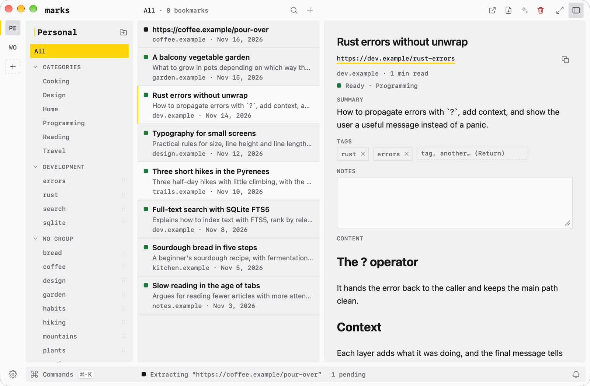

# Profiles

[Español](../es/profiles.md) · **English**

A profile is a separate library, like a browser profile. Use it to keep, say, personal and work apart.

Each profile has its own bookmarks, content, categories, tags, groups and extension token. One profile sees nothing of another, and search doesn't cross profiles.

## The first profile

On first launch marks creates a profile named “Personal”, with the initials “PE”. You can rename it, but **you can't delete it**: its file also holds the list of profiles and the app-wide settings.

## Creating a profile

- The “+” at the end of the rail on the left, or
- the “New profile” command in the palette.

The “New profile” dialog asks for a name (1 to 40 characters) and initials (1 or 2 characters), which are what the rail shows. Two profiles can't share a name.

## Switching profiles

- Click the profile in the rail.
- ⌥⌘1 … ⌥⌘9, for the first nine, by their position in the rail.
- The “Switch to profile “name”” command in the palette.

## Renaming

- Right-click the profile → “Rename”.
- Settings → “Profile”: change “Name” or “Initials” and click “Save”.

## Deleting

Right-click the profile → “Delete profile…” takes you to Settings → “Profile”. There, “Delete profile” asks you to confirm and says how many bookmarks will be deleted.

Deleting a profile removes its file from disk with everything in it. **This can't be undone.** The browser extension that used its token stops working (“The token is not valid.”).

## Moving a bookmark to another profile

- Drag its row onto a profile in the rail.
- Right-click the row → “Move to profile” → the profile.
- With the bookmark selected, the palette command “Move the bookmark to the profile “name””.

The bookmark leaves the list and the app stays on the active profile. In the target profile it keeps its content and is indexed again: its semantic search vectors are recomputed.

If the URL already exists in the target profile, marks refuses the move and says so.

## What belongs to the profile and what to the app

| Per profile | App-wide |
|---|---|
| Bookmarks, content, notes and tags | AI settings and provider keys |
| Categories and groups | Theme, language and corners |
| Extension token | Widths of the areas |
| Import and export | |
| Maintenance (reindex, process without a summary) | |

In Settings, the app's sections sit under “Application” and those of the active profile under “Profile · name”.

## Background work

marks processes the pending bookmarks of **every** profile, not just the active one, taking turns. The status bar only shows the active profile's work.

## With the extension and the command line

- **Extension:** it saves to the profile that owns the token pasted into it, not to the app's active profile. That lets you pair a browser profile with a marks profile. See [Browser extension](browser-extension.md).
- **Command line:** without `--profile <name>` it uses the first profile, not the app's active one. See [Command line](cli.md).

## Where they're stored

One file per profile. See [Data and backups](data-and-backups.md).
