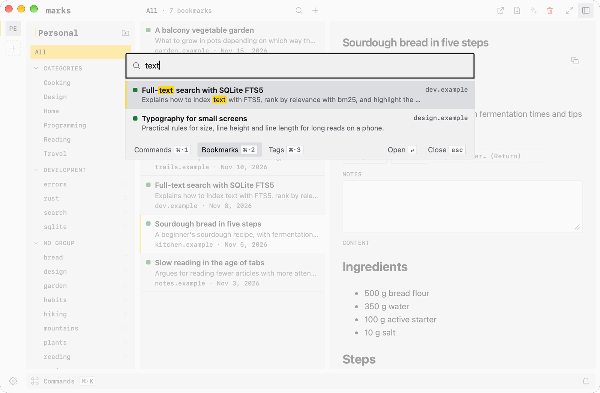

# Search and the command palette

[Español](../es/search.md) · **English**

marks has no search fields scattered around the window. You search, and do almost everything else, from the **command palette**.

## Opening the palette

- ⌘K, from anywhere in the app.
- The “Commands” button in the status bar.
- The “Search” button on the list, which opens it straight in search mode.

The palette has three modes. Switch with the tabs or the keyboard:

| Mode | Shortcut inside the palette | What for |
|---|---|---|
| “Commands” | ⌘1 | Run an app action by name |
| “Bookmarks” | ⌘2 | Search all the bookmarks in the profile |
| “Tags” | ⌘3 | Jump to a tag |

Inside the palette: ↑ and ↓ move the selection, ↵ runs or opens, and `esc` closes.

## Searching bookmarks

Type in “Bookmarks” mode (“Search all bookmarks…”). Results show the title and an excerpt with the matches highlighted. ↵ opens the bookmark in the detail.

Search covers **the whole active profile**, whatever tag or category is selected in the sidebar. There is no search across profiles.

### What gets searched

- **Full text.** Always available. It searches the title, summary, tags, notes, extracted content and page metadata (description, author and site). The URL is not searched. **Every** word you type must appear; there are no operators or wildcards, and each word is matched as typed (so `c++` works).
- **Semantic search.** Only with AI on and an embedding model. It finds pages by meaning, even when they don't contain the exact words.

With AI on, marks merges both result lists into one. Without AI, search is full text only.

A bookmark that is “Not extracted” or was just added can only be found by what it already has: title, tags and notes. A bookmark that isn't “Ready” yet doesn't show up in the semantic part.

The palette shows at most 50 results.

## Commands

“Commands” mode lists the actions available right now. Type part of a name to filter.

Always available:

- “Add bookmark”, “Search all bookmarks”, “New tag group”.
- “Expand or collapse the detail”, “Show or hide the sidebar”.
- “Settings”, “Settings: profile”, “Settings: reindex embeddings”, “Settings: process bookmarks without a summary”, “Settings: test the connection to the model”.
- “Import bookmarks…”, “Export bookmarks…”.
- “Notifications” and, when there are any, “Clear notifications”.
- “New profile” and “Switch to profile “name””, one for each profile other than the active one.
- “Theme: same as the system”, “Theme: light”, “Theme: dark”.
- “Language: …”, one for each language other than the current one.

Depending on what's selected:

- **With a bookmark selected:** “Open the bookmark in the browser”, “Retry the bookmark” (if it failed), “Extract” (if it isn't extracted), “Extract again”, “Extract with AI”, “Delete the bookmark” and “Move the bookmark to the profile “name””.
- **With unextracted bookmarks in the view:** “Extract the N unextracted bookmarks in this view”.
- **For each group:** “Rename the group “name”” and “Delete the group “name””.
- **With a tag selected in the sidebar:** “Move the tag “x” to “group”” and “Remove the tag “x” from its group”.

Commands that start with “Settings:” open that section of Settings; the confirmation and the result show up there.

Every shortcut is listed in [Keyboard shortcuts](shortcuts.md).
