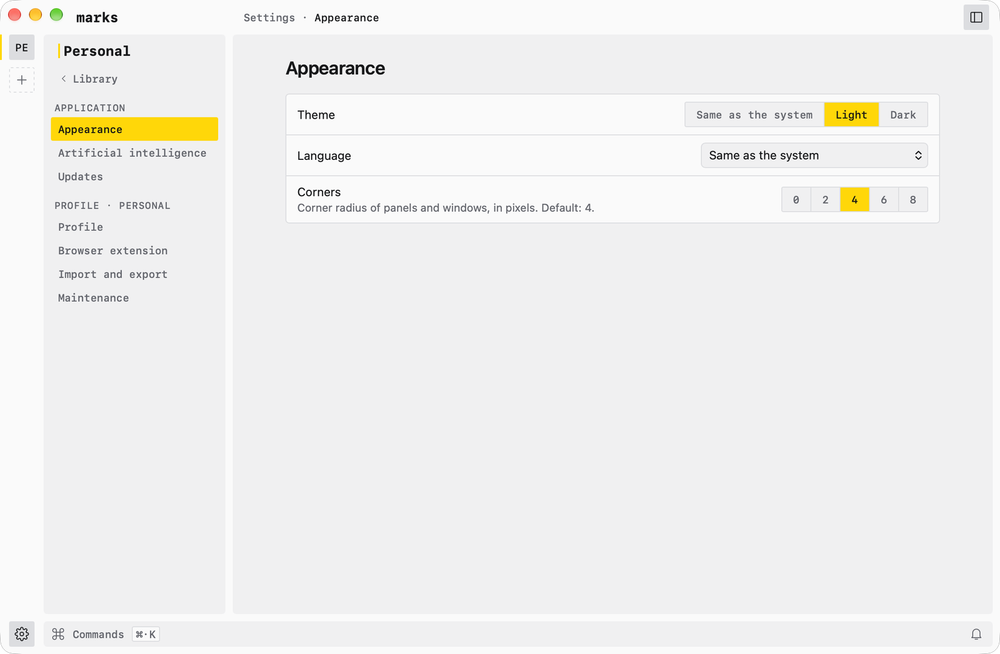
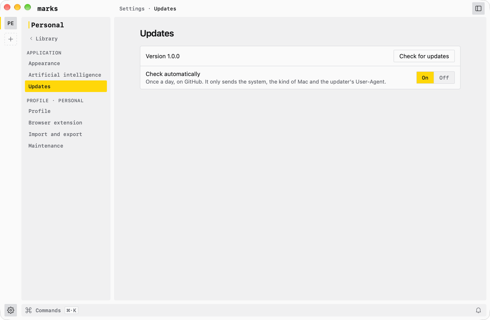
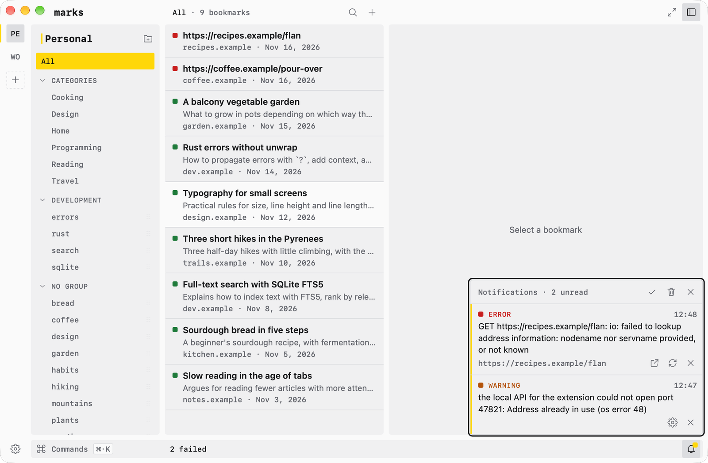

# Settings, notifications and the status bar

[Español](../es/settings.md) · **English**

## Opening Settings

- ⌘,
- The “Settings” button in the window.
- The “Settings” command in the palette.

Settings takes over the window. “Library” goes back to your bookmarks.

The sections come in two blocks:

| Block | Sections | Scope |
|---|---|---|
| “Application” | “Appearance”, “Artificial intelligence”, “Updates” | The whole app |
| “Profile · name” | “Profile”, “Browser extension”, “Import and export”, “Maintenance” | The active profile |

## Appearance

### Theme

“Same as the system”, “Light” or “Dark”. Also from the palette: “Theme: same as the system”, “Theme: light”, “Theme: dark”. The change is immediate.

### Language

“Same as the system”, “Español” or “English”. Also from the palette (“Language: …”).

- With “Same as the system”, marks uses the first language in your macOS language list that is Spanish or English. If neither is there, it uses English.
- Changing the language **relaunches the app**. marks asks first: “marks will relaunch to change the language.”
- The language is stored in the app's macOS preferences, not in the database. This is a macOS-only feature.

The app's language doesn't change the language of your bookmarks or of summaries already written.

### Corners

The corner radius of panels and windows, in pixels: 0, 2, 4, 6 or 8. The default is 4.

## Artificial intelligence

See [Artificial intelligence](ai.md).

## Updates

The version of marks you have and, on an Apple silicon Mac:

- “Check for updates”, which checks now for a new version. If there is one, the button becomes “Install … and restart”.
- “Check automatically”: once a day, on GitHub. On by default.

On an Intel Mac, the section tells you to download new versions from GitHub, with a “See releases” button. See [Updates](updates.md).

## Profile

The name and initials of the active profile, and “Delete profile”. See [Profiles](profiles.md).

## Browser extension

The profile's token and the status of the local API. See [Browser extension](browser-extension.md).

## Import and export

See [Import and export](import-export.md).

## Maintenance

Two actions on the active profile, useful with AI on:

- **“Reindex embeddings”**: recomputes the semantic search vectors of every bookmark in the profile. It asks you to confirm.
- **“Process bookmarks without a summary”**: queues the ones that have no summary. It shows how many there are.

## Window layout

- **Hiding the sidebar:** ⌃⌘S, its button (“Hide sidebar” / “Show sidebar”) or the command “Show or hide the sidebar”.
- **Changing widths:** drag the gap between the sidebar and the list, or between the list and the detail. With the keyboard, focus the gap and use ← and →; hold ⇧ for bigger steps.
- **Expanding the detail:** “Expand” / “Collapse” in the detail, or the command “Expand or collapse the detail”.

The theme, corners, widths and sidebar state are remembered on this computer. They aren't in the database, so they don't travel with a backup.

## Notifications

marks gathers its notices and errors in a panel of its own. It doesn't use macOS system notifications.

- **Opening it:** the bell in the status bar, or the “Notifications” command. The bell shows how many are unread.
- **Toasts:** a new notification appears over the window for about 6 seconds (up to three at a time) and then stays in the panel.

Each notification has a severity (“Error”, “Warning” or “Info”) and may carry an action:

| Action | What it does |
|---|---|
| “Open bookmark” | Goes to the affected bookmark |
| “Retry” | Puts the failed bookmark back in the queue |
| “Open Settings” | Opens the related section of Settings |

In the panel: “Mark all as read”, “Clear” and, on each one, “Dismiss”. “Clear notifications” is in the palette too.

Among other things, marks notifies you about:

- A bookmark that fails to download or process.
- AI being on while the model can't be prepared.
- The local API's port being in use (the extension won't be able to connect).
- “Extract again” and “Extract with AI” finishing.
- The result of importing, exporting and queuing bookmarks.

Details:

- Identical notifications are grouped into one.
- The panel shows those of the active profile plus the app-wide ones.
- **They last for the session:** they are kept in memory, up to 200, and are lost when you quit marks. A failed bookmark's error isn't lost: it stays in its detail.

## Status bar

The strip at the bottom of the window shows, for the active profile:

- “Extracting “title””, while marks extracts a bookmark.
- “N pending”: the ones still waiting to be extracted.
- “N failed”. Clicking it opens the “Failed” filter in the sidebar.

Under the sidebar, the “Commands” button (⌘K). On the right, what applies to the whole app, and the bell:

| Item | What it means | Click |
|---|---|---|
| “AI off” | AI is turned off | Settings → “Artificial intelligence” |
| “AI · model” | AI is on with that model and its last call worked | Settings → “Artificial intelligence” |
| “AI error” | The model couldn't be set up or its last call failed; hover to see the error | Settings → “Artificial intelligence” |
| “Local API” | The extension can connect; hover to see the address | Settings → “Browser extension” |
| “Port 47821 in use” or “Local API stopped” | The extension can't connect | Settings → “Browser extension” |

“AI error” clears with the next call that works (a search, “Test connection” or the next bookmark) or when you save the AI settings. See [Troubleshooting](troubleshooting.md#ai-error-in-the-status-bar).
