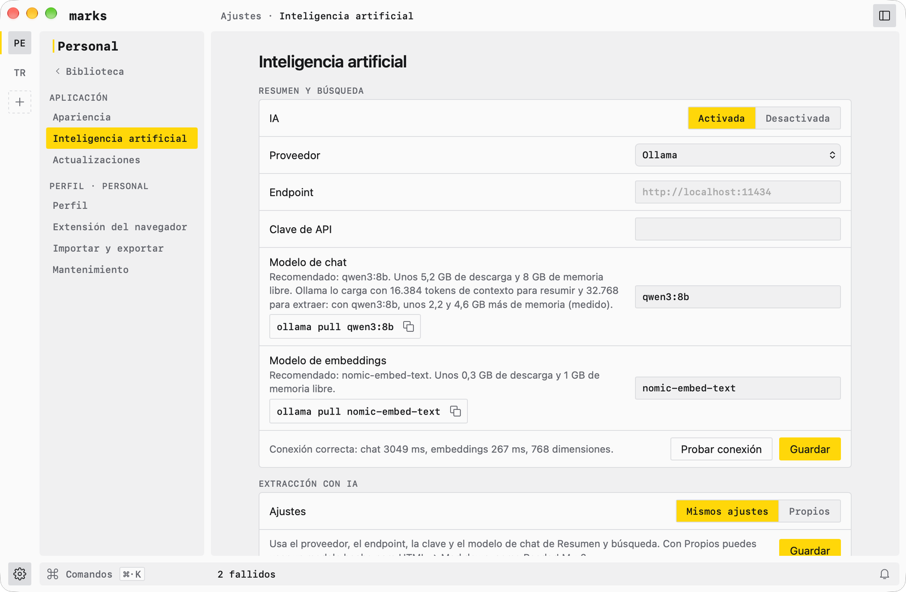

# Inteligencia artificial

**Español** · [English](../en/ai.md)

La IA es opcional y **viene desactivada**. marks funciona sin ella: guarda, extrae, muestra y busca en el texto.

## Qué añade

| Con IA | Sin IA |
|---|---|
| Resumen de cada página | Sin resumen; la lista muestra la descripción de la página |
| Categoría y etiquetas propuestas | Solo tus etiquetas |
| Búsqueda semántica, por significado | Solo búsqueda de texto completo |
| «Extraer con IA» | No disponible |

Sin IA, los bookmarks se extraen y quedan en «Sin resumir». Ajustes lo explica así: «Sin IA: los bookmarks se extraen y quedan pendientes; sin resumen, etiquetas ni búsqueda semántica.»

## Proveedores

| Proveedor | Dónde corre | Endpoint | Clave |
|---|---|---|---|
| «Ollama» (por defecto) | En tu equipo | `http://localhost:11434` si no pones otro | No |
| «oMLX» | En tu equipo o tu red | Obligatorio | Opcional |
| «Compatible con OpenAI» | Donde esté el servidor | Obligatorio | Opcional |
| «OpenAI» | Remoto | El del proveedor | Sí |
| «Anthropic» | Remoto | El del proveedor | Sí |

**Con un proveedor remoto, el contenido de cada página que marks resume sale de tu equipo hacia ese proveedor.** Con Ollama en `localhost`, nada sale. Ver [Privacidad](privacy.md).

Anthropic no ofrece embeddings: con él hay resumen, pero no búsqueda semántica. La app lo avisa: «Anthropic no ofrece embeddings: la búsqueda necesita otro proveedor.»

## Activarla con Ollama (local)

1. Instala [Ollama](https://ollama.com) y déjalo en marcha.
2. Descarga los dos modelos por defecto:

   ```sh
   ollama pull qwen3:8b
   ollama pull nomic-embed-text
   ```

   | Modelo | Para qué | Descarga | Memoria libre |
   |---|---|---|---|
   | `qwen3:8b` | Resumen, categoría y etiquetas | unos 5,2 GB | unos 8 GB |
   | `nomic-embed-text` | Búsqueda semántica | unos 0,3 GB | unos 1 GB |

3. En marks: Ajustes (⌘,) → «Inteligencia artificial».
4. En «IA», elige «Activada».
5. En «Resumen y búsqueda», deja «Proveedor» en «Ollama». «Modelo de chat» y «Modelo de embeddings» ya traen los valores por defecto.
6. Pulsa «Guardar» y, después, «Probar conexión».

«Probar conexión» prueba los ajustes **guardados**. Si va bien, responde algo como «Conexión correcta: chat 850 ms, embeddings 40 ms, 768 dimensiones.»



Junto a cada campo de modelo, la app muestra el recomendado para ese proveedor, el botón «Usar» y, con Ollama, el comando `ollama pull …` con «Copiar comando».

marks pide a Ollama más contexto que el que usa por defecto: 16 384 tokens para resumir y 32 768 para extraer. Eso consume más memoria; con `qwen3:8b`, unos 2,2 y 4,6 GB más.

## Activarla con otro proveedor

1. Ajustes → «Inteligencia artificial» → «IA»: «Activada».
2. Elige el «Proveedor».
3. Si el proveedor lo exige, rellena «Endpoint» («Obligatorio con este proveedor.»).
4. Escribe el «Modelo de chat» y el «Modelo de embeddings».
5. Escribe la «Clave de API», si hace falta.
6. «Guardar» y «Probar conexión».

### Dónde se guarda la clave

Solo en el **llavero de macOS**, en el servicio `dev.landygg.marks`. Nunca en la base de datos ni en un fichero. Cuando hay una guardada, la app dice «Hay una clave guardada en el llavero.» «Borrar clave» la elimina al guardar.

## Después de activarla

Al guardar los ajustes con la IA activada, marks despierta al proceso de fondo: lo que se extrajo sin IA y esperaba su resumen se procesa solo. Lo que guardes a partir de ahora, también.

Los vectores de la búsqueda semántica dependen del modelo de embeddings. Si lo cambias y guardas, marks vuelve a poner en cola los bookmarks de **todos los perfiles** para recalcularlos. Hasta que termine, la búsqueda de un perfil usa solo el texto completo.

En Ajustes → «Mantenimiento» hay dos acciones manuales, por si hacen falta. Son del **perfil activo**:

- «Procesar bookmarks sin resumen» → «Procesar». Muestra cuántos hay pendientes y los pone en cola.
- «Reindexar embeddings» → «Reindexar». Vuelve a calcular los vectores de todos los bookmarks del perfil.

Los ajustes de IA y las claves son de toda la app, no de cada perfil.

## Desactivarla

Ajustes → «Inteligencia artificial» → «IA»: «Desactivada» → «Guardar». marks deja de llamar al modelo a partir del siguiente bookmark. Lo ya resumido se conserva.

## Extraer con IA

Algunas páginas no se extraen bien con el método normal. «Extraer con IA», en el detalle o en la paleta, carga la página en una ventana oculta, limpia su HTML y se lo pasa a un modelo, que lo convierte en Markdown. El bookmark queda marcado como «Extraído con IA».

- Necesita la IA activada y un modelo. Si no, el botón lo dice: «Extraer con IA necesita un modelo: actívala y configúrala en Ajustes → Inteligencia artificial.»
- Si el bookmark ya tiene contenido, pide confirmación, y solo lo sustituye si el resultado es válido.
- La entrada se corta a 60 000 caracteres. La llamada al modelo se da por fallida a los 5 minutos.
- No se ofrece para una página bloqueada por una verificación.

### Un modelo propio para extraer

Por defecto usa el proveedor y el modelo de chat de «Resumen y búsqueda» («Mismos ajustes»). Hay modelos hechos para pasar HTML a Markdown, como ReaderLM-v2, y se pueden usar solo para esto, incluso en otra máquina de tu red:

1. Ajustes → «Inteligencia artificial» → «Extracción con IA» → «Ajustes»: «Propios».
2. Elige el proveedor, el «Endpoint» (por ejemplo `http://192.168.1.20:11434`) y el «Modelo».
3. «Guardar» y «Probar conexión».

Su clave, si hace falta, se guarda en el llavero aparte de la del resumen.

Con un endpoint fuera de tu equipo, la app avisa: «Extraer con IA envía el HTML de la página a un servidor fuera de este equipo.»

## Límites

- El texto que se envía para resumir se corta a 12 000 caracteres.
- Para la búsqueda semántica, cada página se divide en trozos de unos 1 500 caracteres, con un máximo de 40 por página. Lo que pase de ahí no entra en la búsqueda semántica, pero sí en la de texto completo.
- La calidad del resumen, la categoría y las etiquetas depende del modelo que elijas.

Si algo falla, ver [Problemas frecuentes](troubleshooting.md#inteligencia-artificial).
