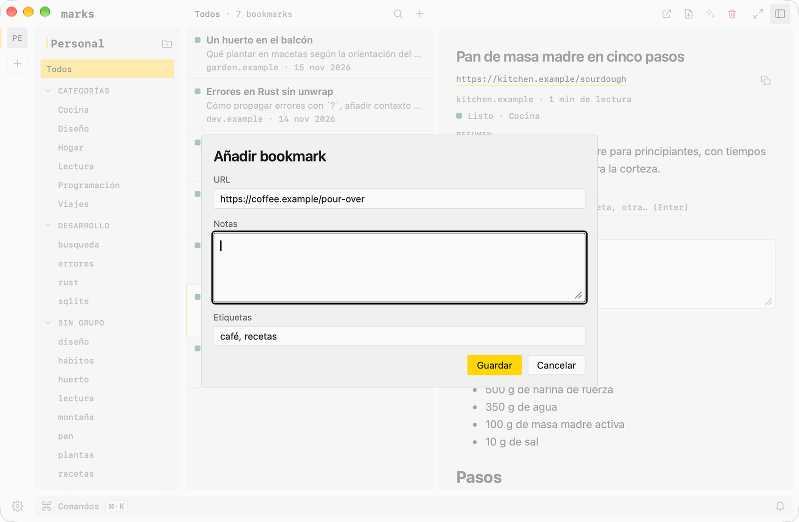
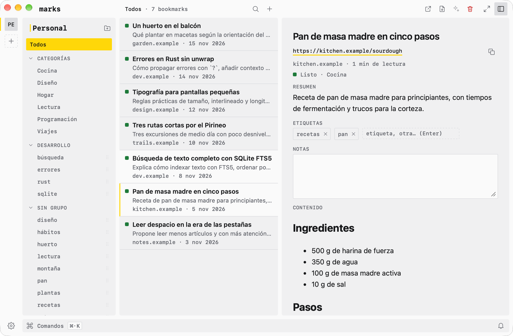

# Guardar y leer bookmarks

**Español** · [English](../en/bookmarks.md)

## Guardar una página

Hay cuatro maneras:

| Desde | Cómo |
|---|---|
| La app | ⌘N, el botón «Añadir» de la lista o el comando «Añadir bookmark» de la paleta |
| La barra de menús | Icono de marks → «Añadir URL…» |
| El navegador | La [extensión](browser-extension.md): clic en su botón o ⌥⇧M |
| La terminal | `marks add <URL>`. Ver [Línea de comandos](cli.md) |

El diálogo «Añadir bookmark» pide la URL y, si quieres, notas y etiquetas (separadas por comas). Solo se guardan URL `http` y `https`.

El bookmark se guarda en el perfil activo. Desde la extensión, en el perfil dueño del token.

### Duplicados

marks no guarda dos veces la misma página en un perfil. Para compararlas, normaliza la URL: quita los parámetros `utm_…` y el fragmento (`#sección`), salvo los que empiezan por `#/` o `#!`, que son rutas de una aplicación web. Si la URL ya estaba, marks devuelve el bookmark que tenía, sin cambiarlo.

La URL tal como la escribiste se conserva: es la que abre «Abrir en el navegador» y la que sale al exportar.

## Qué pasa después de guardar

marks trabaja en segundo plano, bookmark a bookmark y por turnos entre todos los perfiles:

1. **Descarga** la página por HTTP.
2. Si eso falla o trae muy poco texto, la **carga en una ventana oculta**, sin tu sesión del navegador, para que se ejecute su JavaScript.
3. **Extrae** el contenido principal y lo convierte en Markdown. También guarda los metadatos (descripción, autor, sitio, fecha, idioma) y el favicon.
4. Con la IA activada, pide el **resumen**, la categoría y las etiquetas, y calcula los **vectores** para la búsqueda semántica.

Mientras dura la extracción, la fila y el detalle muestran «Extrayendo», y la barra de estado, «Extrayendo «título»».

Lo que guardas desde la extensión llega ya extraído por el navegador, con tu sesión, así que los pasos 1 a 3 no hacen falta.

### Estados

Cada fila lleva un punto de estado:

| Estado | Qué significa |
|---|---|
| «Sin extraer» | Importado de un fichero; marks todavía no ha descargado nada. Ver [Importar y exportar](import-export.md) |
| «Sin resumir» | Guardado y en cola, o ya extraído pero sin resumen. Sin IA, los bookmarks se quedan aquí |
| «Pendiente de indexar» | Resumido; faltan los vectores de la búsqueda semántica |
| «Listo» | Extraído, resumido e indexado |
| «Fallido» | No se pudo descargar o procesar. El detalle muestra el error |

### Cuando falla

El detalle de un bookmark fallido muestra el mensaje de error, con «Copiar mensaje», y el botón «Reintentar». Casos habituales:

- **La página no existe o el servidor falla** (404, 410 o 5xx): marks no insiste con la ventana oculta. Usa «Reintentar» más tarde.
- **La página pide iniciar sesión**: marks no tiene tu sesión. Guárdala desde la extensión.
- **La página pide una verificación antibots** (un captcha): la fila dice «Bloqueada por una verificación». Pulsa «Abrir en el navegador», resuelve la verificación y guárdala con la extensión; el bookmark se completa con ese contenido.

Cada fallo deja además una notificación. Ver [Ajustes, notificaciones y barra de estado](settings.md#notificaciones).

## Leer

Selecciona un bookmark en la lista. El detalle muestra:

- El **título**, que se puede editar.
- La **URL**, acortada si es larga, con «Copiar enlace».
- Una línea de **metadatos**: sitio, autor, fecha y tiempo de lectura (a 200 palabras por minuto).
- El **resumen** de la IA, si lo hay.
- Las **etiquetas**, con un campo para añadir más («etiqueta, otra…» y Enter). Cada una se quita con su ✕.
- Las **notas**, que se guardan solas al escribir.
- El **contenido** extraído.

En la lista, cada fila muestra el resumen o, si no hay, la descripción de la página.

### Cómo se muestra el contenido

El contenido es texto con formato: títulos, listas, citas, tablas, código y enlaces. Por seguridad y privacidad, **marks no carga nada remoto al leer**:

- Las imágenes, los vídeos, el audio y el contenido incrustado aparecen como una línea («Imagen», «Vídeo», «Audio», «Contenido incrustado») con el botón «Abrir», que los abre en el navegador.
- Los enlaces se abren en tu navegador, y solo si son `http` o `https`.
- El HTML de la página no se ejecuta.

El favicon sí se ve: marks lo descarga una vez al guardar y lo conserva en la base de datos.

«Expandir» agranda el detalle hasta tapar la lista; «Contraer» lo devuelve a su sitio.

## Acciones del detalle

La franja superior del detalle tiene un botón por acción. Todas están también en la paleta de comandos.

| Botón | Qué hace |
|---|---|
| «Abrir en el navegador» | Abre la URL original |
| «Reintentar» | Solo en un bookmark fallido: lo vuelve a poner en cola |
| «Extraer» | Solo en uno «Sin extraer»: lo pone en cola |
| «Volver a extraer» | Repite la extracción normal |
| «Extraer con IA» | Extrae con un modelo de IA. Ver [Inteligencia artificial](ai.md#extraer-con-ia) |
| «Eliminar» | Borra el bookmark, tras confirmar. No se puede deshacer |

### Volver a extraer

Sirve cuando el contenido salió incompleto o la página ha cambiado.

- Si el bookmark ya tiene contenido, marks pide confirmación: «Se sustituirá el contenido guardado por el de la nueva extracción.»
- El contenido solo se sustituye si el resultado nuevo es válido. Si sale casi vacío o es una página de verificación, el contenido guardado no se toca y marks muestra el error.
- La página se carga sin tu sesión del navegador.
- No se ofrece para una página bloqueada por una verificación: esa se rescata desde la extensión.

Al terminar, llega la notificación «Volver a extraer terminó».

## Límites

- Una página de más de 8 MB de HTML no se descarga.
- La descarga espera hasta 30 s por petición, y la ventana oculta, hasta 30 s. Un sitio inalcanzable puede tardar alrededor de un minuto en darse por fallido.
- Solo se guardan páginas HTML. Un PDF u otro tipo de fichero acaba en «Fallido».
- Si añades una URL en la app y la guardas desde la extensión mientras marks todavía la descarga, la descarga puede sobrescribir lo capturado por la extensión.
