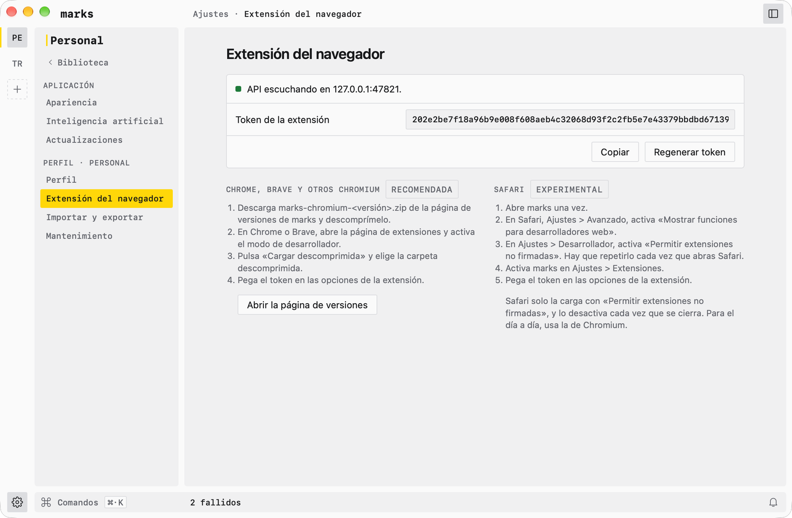

# Extensión del navegador

**Español** · [English](../en/browser-extension.md)

La extensión guarda en marks la pestaña que estás viendo. Envía la página **tal como la ves**, ya renderizada y con tu sesión iniciada, así que sirve también para páginas que piden iniciar sesión, que cargan su contenido con JavaScript o que marks no pudo descargar por una verificación antibots.

Es la misma extensión para Safari y para los navegadores Chromium (Chrome, Brave y otros).

## Cómo funciona

- La extensión habla con la app por una API local, en `127.0.0.1:47821`. **marks tiene que estar abierto** (vale con la ventana cerrada y el icono en la barra de menús).
- Cada perfil de marks tiene un **token**. La extensión guarda en el perfil dueño del token que tenga pegado.
- No hay cola: si marks está cerrado, la extensión no guarda y lo dice («marks no responde. Abre la app e inténtalo de nuevo.»).

## El token

Está en marks → Ajustes (⌘,) → «Extensión del navegador». Es el del perfil activo.

- «Copiar» lo copia al portapapeles.
- «Regenerar token» crea uno nuevo, tras confirmar. La extensión deja de funcionar hasta que pegues el nuevo.

La misma sección indica si la API está en marcha: «API escuchando en 127.0.0.1:47821.»

El token es una contraseña local: quien lo tenga y pueda ejecutar programas en tu equipo puede añadir bookmarks a ese perfil. No lo publiques.

## Chrome, Brave y otros Chromium (recomendada)

Es la extensión recomendada para el día a día.

La v1.0 no está en la Chrome Web Store: se carga sin empaquetar.

1. Descarga `marks-chromium-<versión>.zip` de la [página de versiones](https://github.com/landygg/marks/releases/latest) y descomprímelo en una carpeta que no vayas a borrar: el navegador la carga desde ahí. Desde el código, también vale `apps/extension/dist/chromium`, tras `pnpm --dir apps/extension build` (ver [Compilar](developers/building.md)).
2. Abre `chrome://extensions` y activa el «Modo de desarrollador».
3. Pulsa «Cargar descomprimida» y elige la carpeta descomprimida.
4. Abre las opciones de la extensión, pega el token y pulsa «Guardar token».
5. Pulsa «Probar conexión».

Firefox no está soportado.

## Safari (experimental)

En la v1.0, la extensión de Safari va **dentro de marks.app**, firmada con el mismo certificado autofirmado que la app: no se instala aparte. Tiene su propia versión, y la app le dice si es compatible con ella.

Es experimental porque no está firmada por Apple: Safari solo la carga con «Permitir extensiones no firmadas», y lo desactiva cada vez que se cierra. Para el día a día, usa la de Chromium.

1. Abre marks al menos una vez, para que Safari descubra la extensión.
2. En Safari: Ajustes → Avanzado. Activa «Mostrar funciones para desarrolladores web».
3. En Ajustes → Desarrollador, activa «Permitir extensiones no firmadas». Hay que repetirlo cada vez que abras Safari.
4. En Ajustes → Extensiones, activa «marks».
5. Abre las opciones de la extensión, pega el token en «Token de la API» y pulsa «Guardar token».
6. Pulsa «Probar conexión». Debe responder «Conectado al perfil …».

Más adelante, si se paga el Apple Developer Program, que lo exige, la extensión de Safari pasará a una app propia en el Mac App Store, con su propio ciclo de actualización.

Ten una sola copia de marks.app en el equipo. Con dos (por ejemplo, una instalada y otra compilada), Safari puede cargar la extensión de la que no toca.

## Si la extensión y la app no son compatibles

«Probar conexión» en las opciones de la extensión, o el intento de guardar, lo dice con uno de estos mensajes:

- «Esta versión de marks es demasiado antigua para la extensión. Actualiza marks.»: actualiza la app (Ajustes → Actualizaciones, o descárgala desde [GitHub](https://github.com/landygg/marks/releases)).
- «La extensión es demasiado antigua para esta versión de marks. Actualízala.»: en Chromium, descomprime la versión nueva en la misma carpeta, sustituyendo la vieja, y pulsa «Recargar» en `chrome://extensions`; en Safari, cierra Safari y vuelve a abrirlo, porque la extensión llega con la app.

## Guardar una página

- Clic en el botón de la extensión («Guardar en marks»), o
- el atajo **⌥⇧M** (`Alt+Shift+M`).

La ventanita de la extensión muestra el resultado:

| Mensaje | Qué significa |
|---|---|
| «Guardando…» | En curso. Puedes cerrar la ventanita: el guardado sigue |
| «Guardado en el perfil X.» | Hecho |
| «Ya estaba guardado en el perfil X.» | La URL ya existía. Si le faltaba contenido o había fallado, se completa con el de ahora |
| «La página pide una verificación: resuélvela y vuelve a guardar.» | Lo que se ve es un captcha, no la página |
| «Esta página no se puede guardar.» | No es una página `http` o `https` (por ejemplo, la de ajustes del navegador) |
| «Falta el token de la API.» | No has pegado el token en las opciones |
| «El token no es válido.» | El token se regeneró o su perfil se eliminó |
| «marks no responde. Abre la app e inténtalo de nuevo.» | marks está cerrado |
| «La página es demasiado grande para guardarla.» | Pasa de 8 MB incluso sin el texto de reserva |

Si el guardado falla después de cerrar la ventanita, el icono de la extensión muestra un `!` hasta que la vuelvas a abrir.

El atajo se puede cambiar en los ajustes de atajos de extensiones del navegador.

## Un perfil del navegador por cada perfil de marks

El token se guarda en el almacenamiento de la extensión, que es propio de cada perfil del navegador. Pega en cada perfil del navegador el token de un perfil distinto de marks, y cada uno guardará en el suyo.

## Permisos que pide

| Permiso | Para qué |
|---|---|
| `activeTab` | Leer la pestaña actual, solo cuando pulsas el botón o el atajo |
| `scripting` | Ejecutar en esa pestaña el extractor de contenido |
| `storage` | Guardar el token |
| `nativeMessaging` | Solo en Safari: hablar con marks.app (Chromium no lo pide) |
| `http://127.0.0.1:47821/*` | En Chromium, hablar con la API local de marks |

No pide acceso a todos los sitios, ni al historial, ni a las demás pestañas. No lee nada hasta que tú lo pides.

## Privacidad

- La página se lee sobre una copia: la que tienes delante no cambia.
- Lo extraído va solo a marks, en tu equipo. La extensión no se conecta a ningún otro sitio.
- El token solo vive en el almacenamiento de la extensión y en la cabecera de cada petición. No se pasa a la página.

Limitaciones que conviene conocer están en [Privacidad](privacy.md#la-api-local).

Si algo falla, ver [Problemas frecuentes](troubleshooting.md#extensión-del-navegador).
