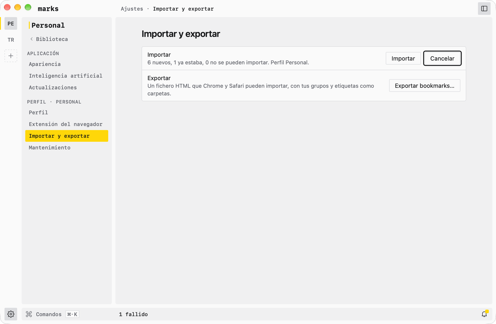

# Importar y exportar

**Español** · [English](../en/import-export.md)

marks intercambia bookmarks con los navegadores mediante el fichero `bookmarks.html`, el formato que Chrome y Safari importan y exportan. Sirve para traer lo que ya tenías y para llevártelo cuando quieras.

Está comprobado con ficheros de Chrome y de Safari. Otros navegadores usan el mismo formato, pero no se han probado.

Todo esto está en Ajustes → «Importar y exportar», y actúa sobre el **perfil activo**.

## Importar

1. Exporta los bookmarks desde tu navegador a un fichero HTML.
2. En marks: Ajustes → «Importar y exportar» → «Importar bookmarks…» (o el comando del mismo nombre en la paleta).
3. Elige el fichero.
4. marks muestra un resumen **antes de escribir nada**, por ejemplo: «12 nuevos, 3 ya estaban, 1 no se puede importar. Perfil Personal.»
5. Pulsa «Importar» para confirmar, o «Cancelar».

El fichero debe estar en UTF-8 y pesar 50 MB como máximo.

### Lo importado no se extrae solo

Un bookmark importado entra con su título, su URL, su fecha y sus carpetas, en el estado **«Sin extraer»**. marks no pide nada a la red al importar: importar mil bookmarks no descarga mil páginas.

Para extraerlos:

- **Uno:** el botón «Extraer» del detalle.
- **Varios:** selecciona una etiqueta (o «Todos») y ejecuta en la paleta «Extraer los N sin extraer de esta vista». marks pide confirmación.

Si la IA está activada, la confirmación avisa: «Con la IA activada, sus N páginas se enviarán a tu proveedor para resumirlas.» Tenlo en cuenta si tu proveedor es remoto.

Guardar de nuevo una URL importada (desde la app, la extensión o la terminal) también la pone en cola.

### Qué pasa con las carpetas

- Una carpeta se convierte en una **etiqueta**, en minúsculas.
- Una carpeta con subcarpetas se convierte en un **grupo**, y las de debajo son sus etiquetas.
- Las carpetas raíz del navegador no dan etiqueta: la barra de marcadores de Chrome y `Favorites`, `Favourites` y `Bookmarks Menu` de Safari.
- La **Lista de lectura** de Safari es un fichero aparte. Sus entradas entran con la etiqueta `lista de lectura` (`reading list` con la app en inglés).

### Lo que ya tenías

Una URL que ya estaba en el perfil no se duplica ni se modifica: solo gana las etiquetas que le falten.

### Lo que no se puede importar

Las entradas que no son `http` ni `https` (por ejemplo `javascript:` o `file:`) y las que tienen una URL no válida se cuentan en «no se puede importar» y se dejan fuera.

## Exportar

1. Ajustes → «Importar y exportar» → «Exportar bookmarks…» (o el comando de la paleta).
2. Elige dónde guardar. marks propone el nombre `marks-<perfil>-<fecha>.html`.

El fichero lleva **todo el perfil**, también lo «Sin extraer» y lo «Fallido», dentro de una carpeta `marks`:

| Bookmark | Carpeta en el fichero |
|---|---|
| Con una etiqueta que está en un grupo | `marks/<grupo>/<etiqueta>/` |
| Con una etiqueta sin grupo | `marks/<etiqueta>/` |
| Sin etiquetas | `marks/Sin etiqueta/` (`marks/Untagged/` con la app en inglés) |

Cada bookmark lleva su URL original (con su `#/…` y sus `utm_`), su fecha y sus etiquetas.

**No se exportan** las notas, el resumen, el contenido extraído ni el favicon: el formato no tiene sitio para ellos. Para una copia completa, copia los ficheros de la base de datos; ver [Datos y copia de seguridad](data-and-backups.md). Para sacar el contenido como Markdown, ver `marks export` en [Línea de comandos](cli.md).

## Límites conocidos

- Un bookmark con varias etiquetas aparece una vez por etiqueta en el navegador que importe el fichero. Al volver a importarlo en marks, se reconoce como uno solo.
- Más de dos niveles de carpetas se aplanan: las carpetas más profundas pasan a ser etiquetas del grupo de arriba.
- Una carpeta raíz de Safari en otro idioma no se reconoce como raíz y se convierte en etiqueta.
- En una ida y vuelta (exportar y volver a importar) se pierden los grupos que no tienen bookmarks.

## Desde la terminal

`marks import <FICHERO>` importa sin preguntar y `marks export-html <FICHERO>` exporta el perfil. Ver [Línea de comandos](cli.md).
