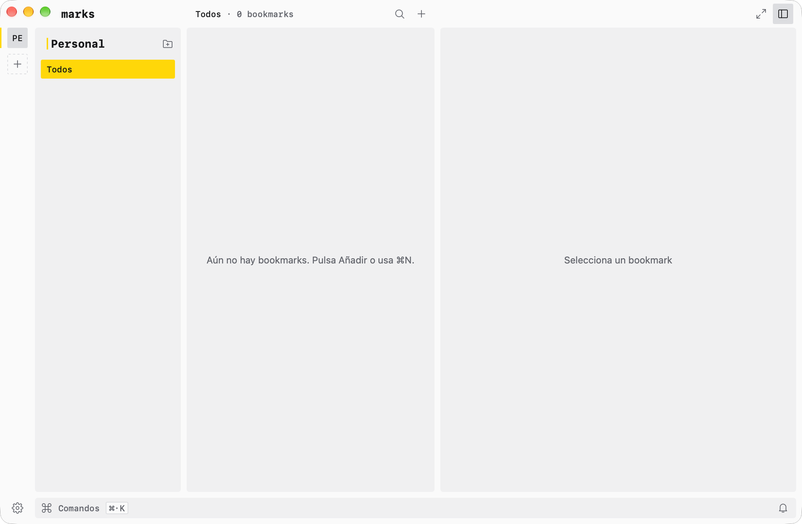

# Instalación y primer arranque

**Español** · [English](../en/installation.md)

## Requisitos

- macOS 14.5 o posterior.
- Mac con Apple Silicon (la única plataforma probada). La versión para Intel se publica sin probar.
- Opcional, para la IA local: [Ollama](https://ollama.com). Ver [Inteligencia artificial](ai.md).

Windows y Linux llegarán más adelante.

## Instalar en macOS

1. Descarga el DMG de la [última versión](https://github.com/landygg/marks/releases/latest): `marks_<versión>_aarch64.dmg` para Apple Silicon, o `marks_<versión>_x64.dmg` para Intel (sin probar).
2. Ábrelo y arrastra **marks** a la carpeta **Aplicaciones**.
3. Abre marks desde Aplicaciones. La primera vez, macOS la bloquea: sigue los pasos de abajo.

### La primera vez: «Abrir igualmente»

marks va firmada, pero no está notarizada por Apple, así que la primera vez macOS no la abre y avisa: «Apple no ha podido verificar que marks no contenga software malicioso que pueda dañar tu Mac o comprometer tu privacidad.»

1. Pulsa «Aceptar» en el aviso (no «Trasladar a la Papelera»).
2. Abre Ajustes del Sistema → Privacidad y seguridad. Al final, junto a «Se ha bloqueado marks para proteger tu Mac.», pulsa «Abrir igualmente». Aparece justo después del intento de abrirla.
3. Confirma con tu contraseña o Touch ID. marks se abre.

En macOS 15 y posteriores, Ctrl+clic → Abrir ya no sirve para esto: hay que pasar por Privacidad y seguridad.

Si lo prefieres, en Terminal (quita la marca de descarga que hace saltar el aviso):

```sh
xattr -dr com.apple.quarantine /Applications/marks.app
```

Solo hace falta la primera vez: las actualizaciones automáticas no vuelven a preguntarlo. Una versión descargada a mano sí, también en Intel, que no se actualiza sola: en cada actualización hay que repetir «Abrir igualmente».

Tras una actualización, si usas un proveedor de IA con clave de API, macOS puede pedir una vez la contraseña del llavero para que marks lea la clave. Pulsa «Permitir siempre».

Para compilar marks desde el código, ver [Compilar](developers/building.md).

## Primer arranque

Al abrirse por primera vez, marks crea su base de datos en `~/Library/Application Support/marks/marks.db` y un primer perfil llamado «Personal», con las iniciales «PE».

La biblioteca está vacía y la app lo dice: «Aún no hay bookmarks. Pulsa Añadir o usa ⌘N.»



### 1. Guarda tu primera página

1. Pulsa ⌘N (o el botón «Añadir» de la lista).
2. Pega una URL. Las notas y las etiquetas son opcionales.
3. Pulsa «Guardar».

El bookmark aparece en la lista. marks descarga la página en segundo plano y, al terminar, el detalle muestra su contenido. Mientras tanto, la fila y la barra de estado dicen «Extrayendo».

### 2. Decide si quieres IA

La inteligencia artificial empieza **desactivada**. Sin ella, marks extrae el contenido y puedes buscar en el texto, pero no hay resumen, ni etiquetas automáticas, ni búsqueda semántica. Los bookmarks quedan en el estado «Sin resumir», y eso es normal.

Para activarla: Ajustes (⌘,) → «Inteligencia artificial». Los pasos están en [Inteligencia artificial](ai.md).

### 3. Conecta el navegador (opcional)

La extensión guarda la pestaña actual con un clic o con ⌥⇧M. Necesita un token que se copia de Ajustes → «Extensión del navegador». Ver [Extensión del navegador](browser-extension.md).

### 4. Trae tus bookmarks (opcional)

Ajustes → «Importar y exportar» → «Importar bookmarks…» lee el fichero `bookmarks.html` que exportan Chrome y Safari. Ver [Importar y exportar](import-export.md).

## marks sigue abierto en la barra de menús

Cerrar la ventana no cierra marks: la ventana se oculta y la app sigue trabajando en segundo plano (extrae lo pendiente y atiende a la extensión).

- Para volver a la ventana: clic en el icono del Dock, o el icono de marks en la barra de menús → «Abrir marks».
- El menú de la barra de menús también tiene «Añadir URL…» y «Salir».
- Para cerrar marks del todo: «Salir» en ese menú, o marks → «Salir de marks» (⌘Q).

## Idioma

marks está en español y en inglés. Usa el idioma del sistema; si no es ninguno de los dos, usa el inglés. Se cambia en Ajustes → «Apariencia» → «Idioma». Ver [Ajustes](settings.md).

## Desinstalar

1. Sal de marks.
2. Arrastra marks de Aplicaciones a la Papelera.
3. Si quieres borrar también tus datos, elimina la carpeta `~/Library/Application Support/marks/`. **Esto borra todos tus bookmarks.** Lo demás que marks deja en el equipo está en [Datos y copia de seguridad](data-and-backups.md).
