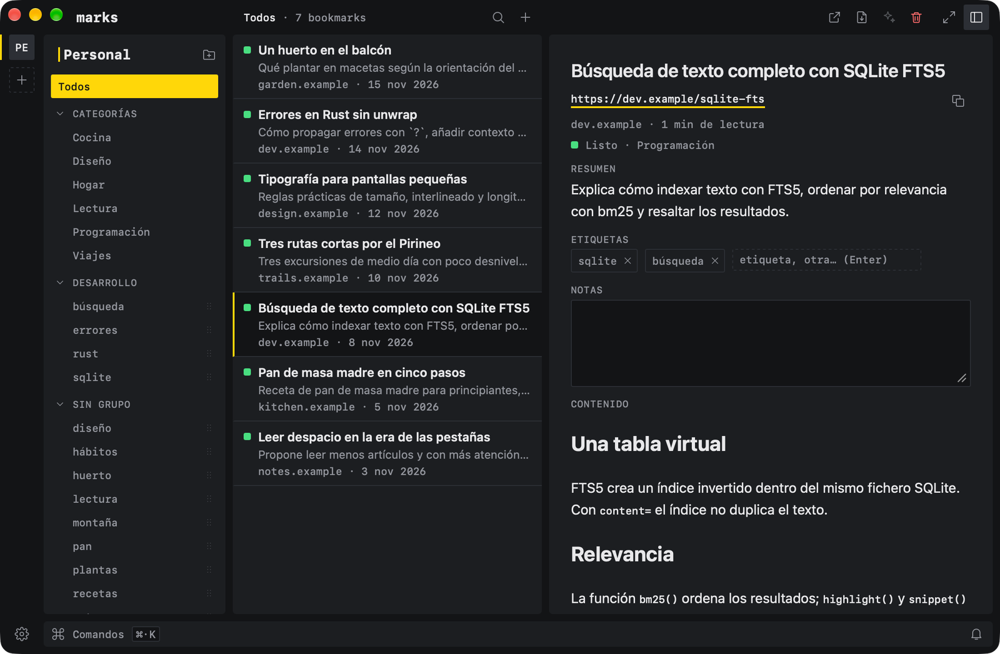

# Qué es marks

**Español** · [English](../en/introduction.md)

marks guarda páginas web para leerlas y encontrarlas después. Le das una URL; marks descarga la página, la convierte en texto limpio (Markdown) y la guarda en tu equipo. Si activas la inteligencia artificial, además la resume, le pone categoría y etiquetas, y la indexa para buscar por significado.

## Qué hace

- **Guarda el contenido, no solo el enlace.** Si la página desaparece, tu copia sigue ahí.
- **Busca en el texto completo** de todo lo guardado: título, contenido, notas y metadatos.
- **Ordena** con etiquetas, grupos de etiquetas y perfiles (bibliotecas separadas).
- **Resume y etiqueta con IA**, si quieres. Viene desactivada.
- **Guarda desde el navegador** con una extensión para Safari y navegadores Chromium.
- **Importa y exporta** el fichero `bookmarks.html` de Chrome y Safari.

## Local-first y privado

- **Tus datos son un fichero en tu equipo.** Cada perfil es una base de datos SQLite en `~/Library/Application Support/marks/`. No hay cuenta, ni servidor de marks, ni sincronización.
- **Funciona sin conexión** para leer, buscar y ordenar. Solo necesita red para descargar las páginas que guardas.
- **La IA es opcional y, por defecto, local.** El proveedor por defecto es [Ollama](https://ollama.com), que corre en tu equipo. Si eliges un proveedor remoto, el contenido de cada página sale hacia él; la app lo avisa.
- **Sin telemetría.** marks no envía estadísticas de uso ni informes de errores.
- **Te lo puedes llevar.** La biblioteca se exporta a `bookmarks.html`, y la línea de comandos la exporta a ficheros Markdown.

El detalle de lo que sale a la red está en [Privacidad](privacy.md).

## La ventana

La ventana tiene cuatro zonas, de izquierda a derecha, y una barra de estado abajo:

1. **Carril de perfiles.** Las iniciales de cada perfil y un «+» para crear otro. Ver [Perfiles](profiles.md).
2. **Barra lateral.** «Todos», las categorías que asigna la IA y tus etiquetas, sueltas o en grupos. Ver [Etiquetas, categorías y grupos](organizing.md).
3. **Lista.** Los bookmarks de lo que esté seleccionado en la barra lateral.
4. **Detalle.** El bookmark seleccionado: título, resumen, etiquetas, notas y contenido. Ver [Guardar y leer bookmarks](bookmarks.md).

La **barra de estado** muestra lo que marks está extrayendo, cuántos bookmarks quedan pendientes o han fallado, el estado de la IA y de la API local, el acceso a la paleta de comandos y la campana de notificaciones.

No hay campos de búsqueda en las zonas. Todo se busca y se ejecuta desde la **paleta de comandos** (⌘K). Ver [Buscar y paleta de comandos](search.md).

La barra lateral se oculta con ⌃⌘S, y la barra lateral y la lista se ensanchan arrastrando el hueco entre zonas.

## Plataformas

| Plataforma | Estado en la v1.0 |
|---|---|
| macOS en Apple Silicon | Probada |
| macOS en Intel | Se publica sin probar |
| Windows y Linux | Más adelante |

marks necesita macOS 15 o posterior.

## Siguiente paso

[Instalación y primer arranque](installation.md).
