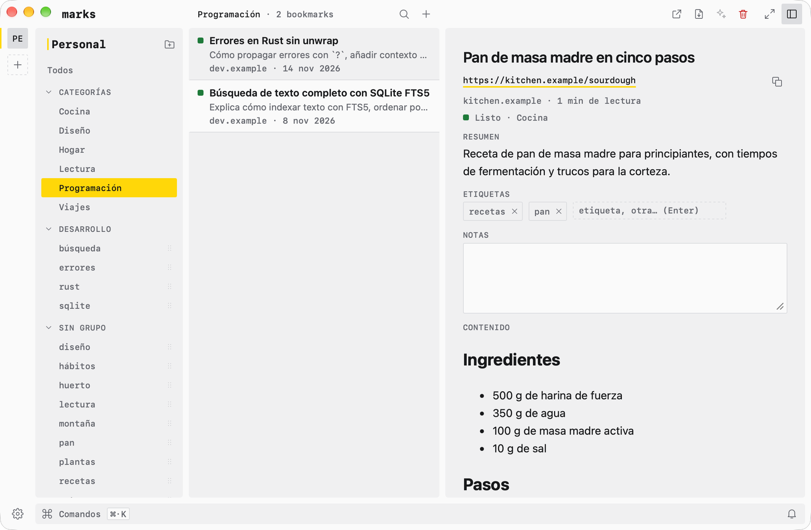

# Etiquetas, categorías y grupos

**Español** · [English](../en/organizing.md)

La barra lateral ordena la biblioteca del perfil activo. De arriba abajo:

- **«Todos»**: todos los bookmarks del perfil.
- **«Fallidos»**: solo los que fallaron, con «Reintentar todos». Sale solo si hay alguno. Ver [Guardar y leer bookmarks](bookmarks.md#ver-y-reintentar-todos-los-fallidos).
- **«Categorías»**: las que asigna la IA.
- **«Etiquetas»**: las tuyas y las de la IA, sueltas («Sin grupo») o dentro de grupos.

Un clic en cualquiera de ellas filtra la lista.

## Etiquetas

Una etiqueta es una palabra o frase corta que tú eliges. Un bookmark puede tener varias.

**Añadir:**

- Al guardar, en el campo «Etiquetas» del diálogo «Añadir bookmark», separadas por comas.
- En el detalle, en «Añadir etiquetas»: escribe una o varias separadas por comas y pulsa Enter.
- Con la IA activada, marks propone etiquetas al resumir.
- Al importar, las carpetas del navegador se convierten en etiquetas.

**Quitar:** en el detalle, con el botón de la etiqueta («Quitar la etiqueta …»).

Las etiquetas se guardan siempre en minúsculas y sin repetir. Una etiqueta existe mientras algún bookmark la tenga: no hay que crearlas ni borrarlas aparte.

Para ir rápido a una etiqueta: paleta (⌘K) → modo «Etiquetas» (⌘3).

## Categorías

La categoría la pone la IA al resumir: una por bookmark. Sin IA no hay categorías. No se editan a mano.

## Grupos de etiquetas

Un grupo reúne etiquetas bajo un nombre, como una carpeta. Una etiqueta está, como mucho, en un grupo.

**Crear un grupo:**

- El botón «Nuevo grupo» de la barra lateral.
- El comando «Nuevo grupo de etiquetas» de la paleta.
- Clic derecho sobre una etiqueta → «Mover a» → «Nuevo grupo…», que crea el grupo y mete la etiqueta en él.

**Mover una etiqueta a un grupo:**

- Arrástrala sobre el grupo.
- Clic derecho sobre la etiqueta → «Mover a» → el grupo. El grupo actual aparece marcado.
- Con la etiqueta seleccionada, el comando «Mover la etiqueta «x» a «grupo»» de la paleta.

**Sacarla del grupo:** clic derecho → «Quitar del grupo», o el comando «Quitar la etiqueta «x» de su grupo». Vuelve a «Sin grupo».

**Renombrar o eliminar un grupo:** clic derecho sobre el grupo → «Renombrar» o «Eliminar grupo», o los comandos «Renombrar el grupo «nombre»» y «Eliminar el grupo «nombre»» de la paleta.

Eliminar un grupo no borra nada más: «Sus etiquetas quedan sin grupo», y los bookmarks conservan sus etiquetas.

## Qué es de cada perfil

Las etiquetas, las categorías y los grupos son de cada perfil. Otro perfil no los ve. Ver [Perfiles](profiles.md).

## Al exportar

Los grupos y las etiquetas salen como carpetas en el fichero `bookmarks.html`. Ver [Importar y exportar](import-export.md).
