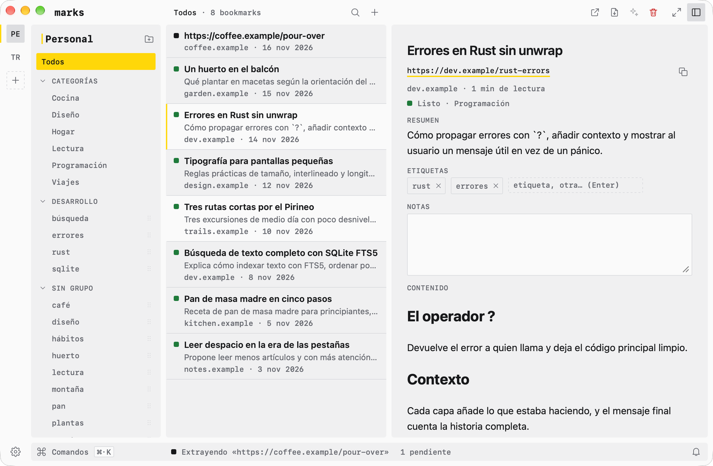

# Perfiles

**Español** · [English](../en/profiles.md)

Un perfil es una biblioteca aparte, como los perfiles de un navegador. Sirve para separar, por ejemplo, lo personal del trabajo.

Cada perfil tiene sus propios bookmarks, contenido, categorías, etiquetas, grupos y token de la extensión. Desde un perfil no se ve nada de otro, y la búsqueda no cruza perfiles.

## El primer perfil

marks crea al arrancar un perfil llamado «Personal», con las iniciales «PE». Se puede renombrar, pero **no se puede eliminar**: su fichero guarda además la lista de perfiles y los ajustes generales de la app.

## Crear un perfil

- El «+» al final del carril de la izquierda, o
- el comando «Nuevo perfil» de la paleta.

El diálogo «Nuevo perfil» pide un nombre (de 1 a 40 caracteres) y unas iniciales (1 o 2 caracteres), que son lo que muestra el carril. Dos perfiles no pueden llamarse igual.

## Cambiar de perfil

- Clic en el perfil, en el carril.
- ⌥⌘1 … ⌥⌘9, para los nueve primeros, según su posición en el carril.
- El comando «Cambiar al perfil «nombre»» de la paleta.

## Renombrar

- Clic derecho sobre el perfil → «Renombrar».
- Ajustes → «Perfil»: cambia «Nombre» o «Iniciales» y pulsa «Guardar».

## Eliminar

Clic derecho sobre el perfil → «Eliminar perfil…» lleva a Ajustes → «Perfil». Allí, «Eliminar perfil» pide confirmación y dice cuántos bookmarks se van a borrar.

Eliminar un perfil borra su fichero del disco con todo su contenido. **No se puede deshacer.** La extensión del navegador que usaba su token deja de funcionar («El token no es válido.»).

## Mover un bookmark a otro perfil

- Arrastra su fila sobre un perfil del carril.
- Clic derecho sobre la fila → «Mover a perfil» → el perfil.
- Con el bookmark seleccionado, el comando «Mover el bookmark al perfil «nombre»» de la paleta.

El bookmark sale de la lista y la app sigue en el perfil activo. En el destino conserva su contenido y se vuelve a indexar: los vectores de la búsqueda semántica se recalculan.

Si la URL ya existe en el perfil de destino, marks rechaza el movimiento y lo dice.

## Qué es del perfil y qué es de la app

| De cada perfil | De toda la app |
|---|---|
| Bookmarks, contenido, notas y etiquetas | Ajustes de IA y claves del proveedor |
| Categorías y grupos | Tema, idioma y esquinas |
| Token de la extensión | Anchos de las zonas |
| Importar y exportar | |
| Mantenimiento (reindexar, procesar sin resumen) | |

En Ajustes, las secciones de la app van bajo «Aplicación» y las del perfil activo, bajo «Perfil · nombre».

## Segundo plano

marks procesa los bookmarks pendientes de **todos** los perfiles, no solo del activo, por turnos. La barra de estado solo muestra lo del perfil activo.

## Con la extensión y la línea de comandos

- **Extensión:** guarda en el perfil dueño del token que tenga pegado, no en el perfil activo de la app. Así, un perfil del navegador se puede emparejar con un perfil de marks. Ver [Extensión del navegador](browser-extension.md).
- **Línea de comandos:** sin `--profile <nombre>` usa el primer perfil, no el activo de la app. Ver [Línea de comandos](cli.md).

## Dónde se guardan

Un fichero por perfil. Ver [Datos y copia de seguridad](data-and-backups.md).
