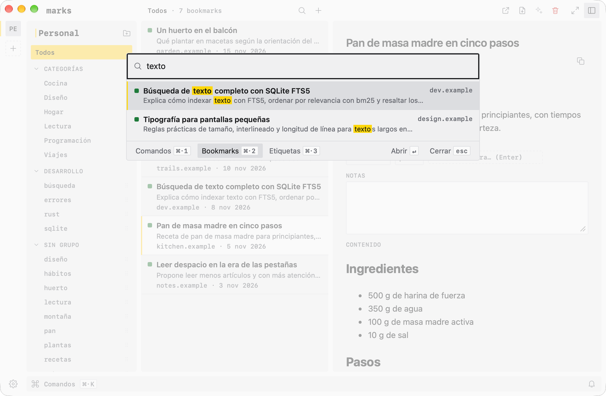

# Buscar y paleta de comandos

**Español** · [English](../en/search.md)

En marks no hay campos de búsqueda repartidos por la ventana. Se busca, y se hace casi todo lo demás, desde la **paleta de comandos**.

## Abrir la paleta

- ⌘K, desde cualquier parte de la app.
- El botón «Comandos» de la barra de estado.
- El botón «Buscar» de la lista, que la abre ya en modo de búsqueda.

La paleta tiene tres modos. Se cambia con las pestañas o con el teclado:

| Modo | Atajo dentro de la paleta | Para qué |
|---|---|---|
| «Comandos» | ⌘1 | Ejecutar una acción de la app por su nombre |
| «Bookmarks» | ⌘2 | Buscar en todos los bookmarks del perfil |
| «Etiquetas» | ⌘3 | Ir a una etiqueta |

Dentro de la paleta: ↑ y ↓ mueven la selección, ↵ ejecuta o abre, y `esc` cierra.

## Buscar bookmarks

Escribe en el modo «Bookmarks» («Buscar en todos los bookmarks…»). Los resultados muestran el título y un fragmento con las coincidencias resaltadas. ↵ abre el bookmark en el detalle.

La búsqueda cubre **todo el perfil activo**, sin importar qué etiqueta o categoría esté seleccionada en la barra lateral. No hay búsqueda entre perfiles.

### En qué se busca

- **Texto completo.** Siempre disponible. Busca en el título, el resumen, las etiquetas, las notas, el contenido extraído y los metadatos de la página (descripción, autor y sitio). La URL no entra. Deben aparecer **todas** las palabras que escribas; no hay operadores ni comodines, y cada palabra se busca tal cual (así `c++` funciona).
- **Búsqueda semántica.** Solo con la IA activada y un modelo de embeddings. Encuentra páginas por significado, aunque no contengan las palabras exactas.

Con la IA activada, marks combina las dos listas de resultados en una sola. Sin IA, la búsqueda es solo de texto completo.

Un bookmark «Sin extraer» o recién añadido solo se encuentra por lo que ya tiene: título, etiquetas y notas. Un bookmark que aún no está «Listo» no aparece en la parte semántica.

La paleta muestra como mucho 50 resultados.

## Comandos

El modo «Comandos» lista las acciones disponibles en ese momento. Escribe parte del nombre para filtrar.

Siempre disponibles:

- «Añadir bookmark», «Buscar en todos los bookmarks», «Nuevo grupo de etiquetas».
- «Expandir o contraer el detalle», «Mostrar u ocultar la barra lateral».
- «Ajustes», «Ajustes: perfil», «Ajustes: reindexar embeddings», «Ajustes: procesar bookmarks sin resumen», «Ajustes: probar conexión con el modelo».
- «Importar bookmarks…», «Exportar bookmarks…».
- «Notificaciones» y, si hay alguna, «Vaciar notificaciones».
- «Nuevo perfil» y «Cambiar al perfil «nombre»», uno por cada perfil que no sea el activo.
- «Tema: como el sistema», «Tema: claro», «Tema: oscuro».
- «Idioma: …», uno por cada idioma que no sea el actual.

Según lo seleccionado:

- **Con un bookmark seleccionado:** «Abrir el bookmark en el navegador», «Reintentar el bookmark» (si falló), «Extraer» (si está sin extraer), «Volver a extraer», «Extraer con IA», «Eliminar el bookmark» y «Mover el bookmark al perfil «nombre»».
- **Con bookmarks sin extraer en la vista:** «Extraer los N sin extraer de esta vista».
- **Por cada grupo:** «Renombrar el grupo «nombre»» y «Eliminar el grupo «nombre»».
- **Con una etiqueta seleccionada en la barra lateral:** «Mover la etiqueta «x» a «grupo»» y «Quitar la etiqueta «x» de su grupo».

Los comandos que empiezan por «Ajustes:» abren esa sección de Ajustes; la confirmación y el resultado se ven allí.

Todos los atajos están en [Atajos de teclado](shortcuts.md).
