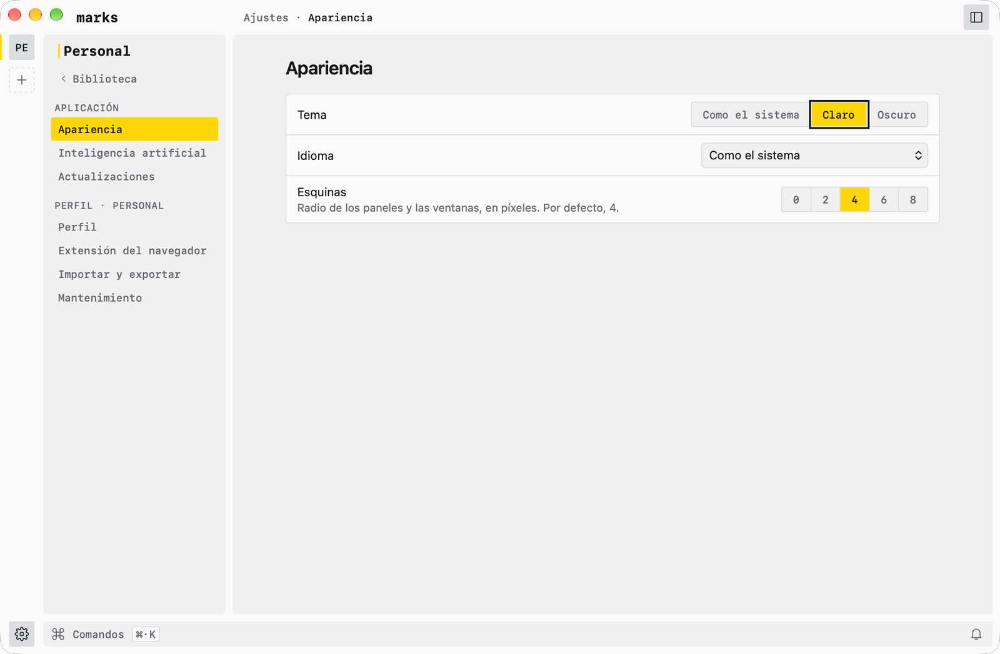
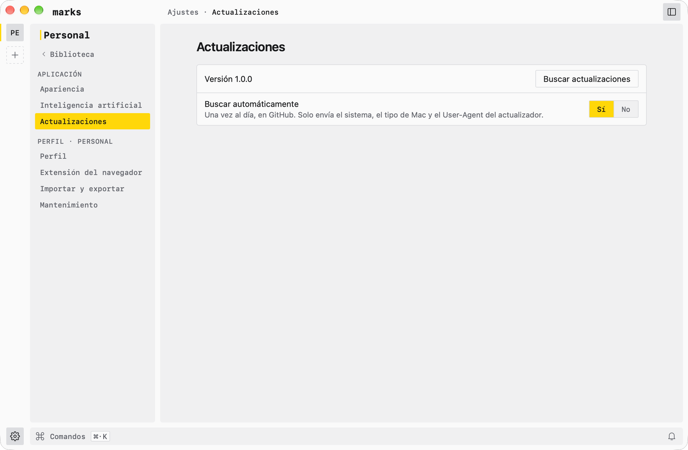
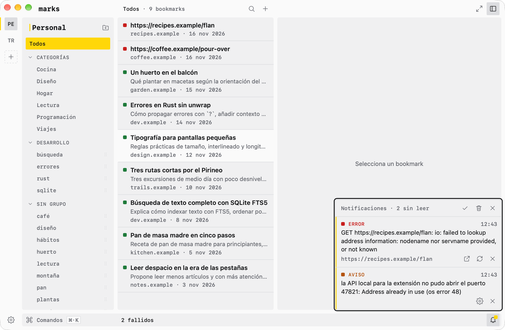

# Ajustes, notificaciones y barra de estado

**Español** · [English](../en/settings.md)

## Abrir Ajustes

- ⌘,
- El botón «Ajustes» de la ventana.
- El comando «Ajustes» de la paleta.

Ajustes ocupa la ventana. «Biblioteca» vuelve a los bookmarks.

Las secciones van en dos bloques:

| Bloque | Secciones | Ámbito |
|---|---|---|
| «Aplicación» | «Apariencia», «Inteligencia artificial», «Actualizaciones» | Toda la app |
| «Perfil · nombre» | «Perfil», «Extensión del navegador», «Importar y exportar», «Mantenimiento» | El perfil activo |

## Apariencia

### Tema

«Como el sistema», «Claro» u «Oscuro». También desde la paleta: «Tema: como el sistema», «Tema: claro», «Tema: oscuro». El cambio es inmediato.

### Idioma

«Como el sistema», «Español» o «English». También desde la paleta («Idioma: …»).

- Con «Como el sistema», marks usa el primer idioma de tu lista de idiomas de macOS que sea español o inglés. Si no hay ninguno, usa el inglés.
- Cambiar de idioma **reinicia la app**. marks pide confirmación antes: «marks se reiniciará para cambiar el idioma.»
- El idioma se guarda en las preferencias de macOS de la app, no en la base de datos. Es una función propia de macOS.

El idioma de la app no cambia el de tus bookmarks ni el de los resúmenes ya hechos.

### Esquinas

El radio de las esquinas de los paneles y las ventanas, en píxeles: 0, 2, 4, 6 u 8. Por defecto, 4.

## Inteligencia artificial

Ver [Inteligencia artificial](ai.md).

## Actualizaciones

La versión de marks que tienes y, en un Mac con Apple silicon:

- «Buscar actualizaciones», que comprueba ahora si hay una versión nueva. Si la hay, el botón pasa a «Instalar … y reiniciar».
- «Buscar automáticamente»: una vez al día, en GitHub. Activado por defecto.

En un Mac con Intel, la sección dice que descargues las versiones nuevas desde GitHub, con un botón «Ver versiones». Ver [Actualizaciones](updates.md).

## Perfil

Nombre e iniciales del perfil activo, y «Eliminar perfil». Ver [Perfiles](profiles.md).

## Extensión del navegador

El token del perfil y el estado de la API local. Ver [Extensión del navegador](browser-extension.md).

## Importar y exportar

Ver [Importar y exportar](import-export.md).

## Mantenimiento

Dos acciones sobre el perfil activo, útiles con la IA activada:

- **«Reindexar embeddings»**: vuelve a calcular los vectores de la búsqueda semántica de todos los bookmarks del perfil. Pide confirmación.
- **«Procesar bookmarks sin resumen»**: pone en cola los que no tienen resumen. Muestra cuántos hay.

## Disposición de la ventana

- **Ocultar la barra lateral:** ⌃⌘S, su botón («Ocultar barra lateral» / «Mostrar barra lateral») o el comando «Mostrar u ocultar la barra lateral».
- **Cambiar anchos:** arrastra el hueco entre la barra lateral y la lista, o entre la lista y el detalle. Con el teclado, pon el foco en el hueco y usa ← y →; con ⇧, en pasos más grandes.
- **Expandir el detalle:** «Expandir» / «Contraer» en el detalle, o el comando «Expandir o contraer el detalle».

El tema, las esquinas, los anchos y el plegado de la barra lateral se recuerdan en este equipo. No van en la base de datos, así que no viajan con una copia de seguridad.

## Notificaciones

marks reúne sus avisos y errores en un panel propio. No usa las notificaciones del sistema de macOS.

- **Abrirlo:** la campana de la barra de estado, o el comando «Notificaciones». La campana indica cuántas hay sin leer.
- **Avisos emergentes:** una notificación nueva aparece unos 6 segundos sobre la ventana (hasta tres a la vez) y después queda en el panel.

Cada notificación tiene una gravedad («Error», «Aviso» o «Info») y puede traer una acción:

| Acción | Qué hace |
|---|---|
| «Abrir bookmark» | Va al bookmark afectado |
| «Reintentar» | Vuelve a poner en cola el bookmark fallido |
| «Abrir Ajustes» | Abre la sección de Ajustes relacionada |

En el panel: «Marcar todo como leído», «Vaciar» y, en cada una, «Descartar». «Vaciar notificaciones» también está en la paleta.

Qué notifica marks, entre otras cosas:

- Un bookmark que falla al descargarse o procesarse.
- La IA activada sin que el modelo se pueda preparar.
- El puerto de la API local ocupado (la extensión no podrá conectarse).
- El final de «Volver a extraer» y de «Extraer con IA».
- El resultado de importar, exportar y poner bookmarks en cola.

Detalles:

- Las notificaciones iguales se agrupan en una sola.
- El panel muestra las del perfil activo y las generales de la app.
- **Son de la sesión:** se guardan en memoria, hasta 200, y se pierden al salir de marks. El error de un bookmark fallido no se pierde: sigue en su detalle.

## Barra de estado

La franja inferior de la ventana muestra, del perfil activo:

- «Extrayendo «título»», mientras marks extrae un bookmark.
- «N pendientes»: los que aún esperan extracción.
- «N fallidos».

A la derecha, el botón «Comandos» (⌘K) y la campana.
